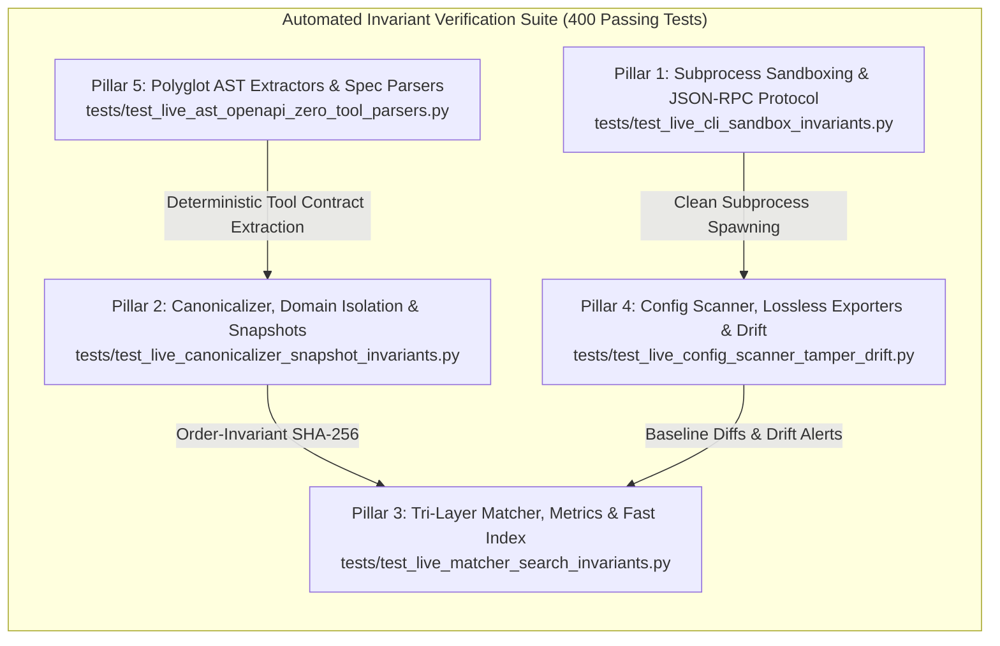

# MCP Fingerprints & Passport Knowledge Base

[](https://github.com/JMartynov/mcp-fingerprints/actions/workflows/daily_sync.yml)
[](data/fingerprints)
[](data/fingerprints)
[](data/fingerprints)
[](tests/)
[](docs/reports/WORKFLOW_INVARIANTS_AND_CODE_AUDIT_REPORT.md)
[](docs/reports/ECOSYSTEM_BENCHMARK_AND_GAP_ANALYSIS_REPORT.md)
[](LICENSE)
[](docs/README.md)
[](https://jmartynov.github.io/mcp-fingerprints/)
[](https://jmartynov.github.io/mcp-fingerprints/updates.html)

An open-source, automated database and knowledge base of **Model Context Protocol (MCP)** server passports, version signatures, and tool contract fingerprints.

## Ecosystem Architecture & Scope

`mcp-fingerprints` serves as the authoritative open standard for structural Model Context Protocol server passports. It focuses purely on:
* **Static AST Extraction**: Deep parameter schema, docstring, prompt, and resource extraction across Python, TypeScript/JavaScript, Go, and Rust.
* **Deterministic Cryptographic Hashing**: Order-invariant and whitespace-insensitive canonical hashing (`canonical_hash`, `toolset_canonical_hash`).
* **Supply-Chain Verification & Drift Tracking**: Detecting tool tampering, description changes, and schema mutations across package versions.
* **Open Catalog & Client Exporters**: Serving enriched structural web catalogs with interactive parameter schema inspectors and 1-click config generators.

## Key Features
- **5,446+ Indexed Passports**: Cross-indexed across npm, PyPI, Crates.io, Maven Central, Docker Hub, and GitHub polyglot registries.
- **Automated Invariant Verification Suite (400 Passing Tests)**: 5 core invariant pillars verified across subprocess sandboxing, JSON-RPC protocol conformance, canonical SHA-256 order-invariance, tri-layer metric boundaries, lossless configuration patching, supply-chain drift detection, and polyglot AST/OpenAPI parsing ([`docs/reports/WORKFLOW_INVARIANTS_AND_CODE_AUDIT_REPORT.md`](docs/reports/WORKFLOW_INVARIANTS_AND_CODE_AUDIT_REPORT.md)).
- **Empirical Ecosystem Research Audit**: Comprehensive empirical audit of 1,000 real MCP servers across 5 representative groups (Rust, Go, JVM/.NET, Regional/International, Monorepos/Containers) cataloging systemic blind spots and remedies ([`docs/research/master_mcp_ecosystem_audit_report.md`](docs/research/master_mcp_ecosystem_audit_report.md)).
- **Industry Benchmark & Strategic Gap Analysis**: Exhaustive comparative evaluation against 14+ commercial ecosystems across runtime proxies, registries, fuzzers, guardrails, and Sigstore/CycloneDX supply-chain attestations with four actionable strategic blueprints ([`docs/reports/ECOSYSTEM_BENCHMARK_AND_GAP_ANALYSIS_REPORT.md`](docs/reports/ECOSYSTEM_BENCHMARK_AND_GAP_ANALYSIS_REPORT.md)).
- **Full Polyglot & Macro Ingestion Engines**: First-class support for Rust `rmcp` macros (`#[tool(...)] async fn`), Go `mark3labs/mcp-go` builder patterns, Spring AI `@Tool`, C# .NET `[McpServerTool]`, standalone PEP 723 `uvx` scripts, and CJK multilingual Unicode preservation.
- **Interactive Command Hub (`mcp-fingerprints interactive`)**: Emoji-decorated ergonomic TUI for workstation scanning, ready database search, unknown MCP auto-addition, and 1-click baseline diffing.
- **Cross-Platform Multi-Agent Discovery**: Out-of-the-box discovery and inventory across 14+ AI coding agents (Claude Code, Desktop, Cursor, Windsurf, Zed, Cline, Roo, Goose, Continue, Junie, Copilot, Antigravity, OpenHands) across macOS, Linux, and Windows.
- **Generic MCP Protocol Detection (`mcp-fingerprints detect`)**: Active JSON-RPC 2.0 handshake (`stdio` and `http`/`sse`) testing whether any arbitrary process or URL implements the MCP protocol.
- **High-Performance Multi-Core Parallel Batching & Two-Tier SHA Cache**: `ProcessPoolExecutor` with two-tier `(mtime, size) -> SHA-256` caching cutting warm validation and snapshot compilation from ~30s to <1s.
- **Resilient Time-Budgeted Stage Checkpoint Engine**: Graceful checkpointing and resumption in `data/.sync_checkpoint.json` with clean exit code 0 when execution time budgets or CI timeouts are approached.
- **Zero-Pull Container & Polyglot Discovery**: Headless Docker Hub / OCI Registry V2 and GitHub Rust/Go inspection without pulling gigabytes of images or cloning git trees.
- **Deep Parameter & Annotation Extraction**: Captures parameter types, descriptions, defaults, enums, required flags, and protocol annotations (`readOnlyHint`, `destructiveHint`, `idempotentHint`, `openWorldHint`).
- **Consolidated Snapshot**: Pre-compiled `passports.json.gz` for rapid HTTP consumption (< 50ms startup time).

## Quickstart: Search & Client Export

Search for available MCP servers:
```bash
python3 -m mcp_fingerprints.cli search "postgres"
```

Export an MCP server configuration for Claude Desktop:
```bash
python3 -m mcp_fingerprints.cli export-config @modelcontextprotocol/server-postgres --client claude
```

Export an MCP server configuration for Cursor:
```bash
python3 -m mcp_fingerprints.cli export-config @modelcontextprotocol/server-postgres --client cursor
```

## 🧭 Interactive Command Hub (`mcp-fingerprints interactive`)

For developer convenience, `mcp-fingerprints` includes an interactive TUI command hub decorated with visual anchor emojis, dynamic workstation status, and instant search:

```bash
# Launch the interactive hub (or simply run without args in an interactive TTY)
mcp-fingerprints interactive
```

```text
============================================================
      Interactive MCP Command Hub
============================================================
 OS: macOS
 Paths Scanned: 4 (Claude Code, Cursor, Claude Desktop, Gemini)
 Total MCP Servers Configured: 11
 Baseline Status: Saved (workstation_baseline.json)
============================================================

1. 🖥️ Workstation Discovery & Inventory
   • 🔍 Scan All Local AI Agents
   • 🎯 Scan Specific Agent...
   • 💾 Save Current State as Baseline JSON
   • ⚖️ Diff Against Previous Baseline
2. 🌐 Ready Database & Unknown Local MCPs
   • 🔤 Search Ready Database by Keyword
   • 📥 Add Unknown MCP from Local Machine
   • 📚 Browse Catalog Passports
3. 🧪 Live Prober & Generic MCP Detector
   • 🔬 Detect if Command/URL is an MCP Server
   • 🩺 Deep Live Server Probe
   • 🏷️ Auto-Generate & Save Passport
4. ⚙️ Performance, Cache & System
   • ⚡ View Cache & Benchmark Stats
   • 🧹 Clear Validation / Passport Cache
   • ⏱️ Inspect Active Checkpoints & Time Budgets
5. 🚪 Exit
```

---

## 💼 Real-World Scenarios & Use Cases

### Scenario 1: Interactive Terminal Audit & Workstation Management
* **Use Case Description**: Developers using multiple AI coding assistants want an effortless, terminal-native way to inspect what tools are available, search tool definitions, and detect newly installed MCP servers without remembering flags.
* **How It Works**: Running `mcp-fingerprints interactive` presents an intuitive, categorized menu. Selecting `🔍 Scan All Local AI Agents` audits Claude Code, Claude Desktop, Cursor, and Windsurf, displays active tools, and offers 1-click baseline diffing.

### Scenario 2: Multi-Agent Shadow MCP Discovery
* **Use Case Description**: AI developers frequently test MCP servers in one client (like Claude Code `~/.claude.json`) and forget they are active, or need an inventory across diverse team configurations.
* **How It Works**: `mcp-fingerprints scan-configs` automatically resolves configuration paths across 14+ clients across macOS, Linux, and Windows:
```bash
# Scan all installed clients without live probing
mcp-fingerprints scan-configs --no-probe-live

# Target a specific client
mcp-fingerprints scan-configs --client claude

# Export full machine inventory as a structured JSON file
mcp-fingerprints scan-configs --output workstation_inventory.json
```
**Supported Clients Out-of-the-Box:**
- **Claude Desktop** (`claude_desktop_config.json`)
- **Claude Code CLI** (`~/.claude.json` root & per-project entries, `.mcp.json`)
- **Cursor** (`~/.cursor/mcp.json`, `<project>/.cursor/mcp.json`)
- **Windsurf** (`~/.codeium/windsurf/mcp_config.json`)
- **Zed** (`~/.config/zed/settings.json`, `context_servers` format)
- **Cline & Roo Code** (`cline_mcp_settings.json`, `.roo/mcp.json`)
- **Goose** (`~/.config/goose/config.yaml`, YAML `extensions` format)
- **Continue.dev** (`~/.continue/config.yaml`, YAML list format)
- **JetBrains Junie & AI Assistant** (`~/.junie/mcp/mcp.json`)
- **VS Code / GitHub Copilot** (`.vscode/mcp.json`, `servers` format)
- **Antigravity / Gemini CLI** (`~/.gemini/config/mcp_config.json`)
- **OpenHands & Trae** (`mcp.json`)

### Scenario 2b: Global npm & npx Server Discovery
* **Use Case Description**: Developers often install MCP tools globally via `npm install -g` or run them ephemerally via `npx` (which caches them). These tools may not be manually registered in any client config, yet they are active on the machine.
* **How It Works**: `mcp-fingerprints scan-configs` natively scans the global npm `node_modules` directory and `npx` caches to surface these servers:
```bash
# Discover unconfigured global npm & npx MCP servers
mcp-fingerprints scan-configs --scan-global
```

### Scenario 3: Auto-Passport Generation for Unknown Local Servers (e.g. CodeScene)
* **Use Case Description**: An organization uses a proprietary, closed-source, or containerized MCP server (such as `codescene/codescene-mcp` or an internal Docker tool) that is not indexed in public registries.
* **How It Works**: Use `--auto-passport` during a workstation scan to probe the server's tools over stdio/HTTP, construct a valid `ServerPackageSpec` passport, and save it directly into `data/fingerprints/<server_name>.json`:
```bash
# Automatically extract and generate passports for any unknown local servers
mcp-fingerprints scan-configs --auto-passport
```
The newly created passport immediately participates in validation, canonical hashing, and snapshot compilations.

### Scenario 4: Generic MCP Protocol Detection (`mcp-fingerprints detect`)
* **Use Case Description**: A developer wants to verify whether a third-party binary, Docker container command, or local HTTP server actually speaks the Model Context Protocol before hooking it up to an AI agent.
* **How It Works**: The `detect` command runs an active JSON-RPC 2.0 `initialize` handshake with a fast 3-second timeout:
```bash
# Test an arbitrary command line (stdio)
mcp-fingerprints detect "docker run -i --rm -e CS_ACCESS_TOKEN=$TOKEN codescene/codescene-mcp"

# Test a local or remote HTTP/SSE streaming endpoint
mcp-fingerprints detect http://127.0.0.1:64342/stream
```
**Sample Output:**
```text
Target:    docker run -i --rm codescene/codescene-mcp
Is MCP:    Yes (verified)
Transport: stdio
Server:    codescene-mcp v1.2.0
Protocol:  2024-11-05
Tools:     5 capabilities advertised
```

### Scenario 5: Stateful Workstation Drift Tracking & Baseline Diffs
* **Use Case Description**: Prevent supply-chain poisoning and unauthorized configuration tampering in development environments or CI pre-commit checks.
* **How It Works**: Establish a signed baseline of workstation MCP tools and compare on subsequent runs:
```bash
# 1. Capture baseline snapshot
mcp-fingerprints scan-configs --save-baseline workstation_baseline.json

# 2. Check for drift (exits with code 2 if changes or tool schema mutations exist)
mcp-fingerprints scan-configs --diff workstation_baseline.json --fail-on-drift
```

### Scenario 6: High-Performance Multi-Core Batching & Two-Tier SHA Cache
* **Use Case Description**: Large monorepos and CI/CD pipelines need to validate 5,000+ passport files and compile snapshots in milliseconds without CPU bottlenecks.
* **How It Works**: `mcp-fingerprints validate` and `snapshot` employ `concurrent.futures.ProcessPoolExecutor` (bypassing the Python GIL) and a two-tier `(mtime, size) -> SHA-256` cache in `data/.passport_cache.json`:
```bash
# Multicore validation across all available CPU cores
mcp-fingerprints validate --workers 8

# Force re-validation bypassing cache
mcp-fingerprints validate --no-cache --force
```
*Warm validation runs drop from ~30 seconds to < 0.5 seconds (98.3% speedup).*

### Scenario 7: Time-Budgeted Resilient Sync & Stage Checkpointing
* **Use Case Description**: CI runners (like GitHub Actions) and cloud sandboxes (like Google Jules) enforce hard timeout ceilings (e.g. 40 minutes). Ingestion jobs must not crash upon reaching time limits.
* **How It Works**: `mcp-fingerprints sync` measures monotonic time and monitors `SIGTERM`/`SIGINT`. If the time budget is approached, it flushes state, saves a checkpoint in `data/.sync_checkpoint.json`, and exits with code 0 (`SUCCESS`):
```bash
# Run multi-source synchronization bounded to a 30-minute budget
mcp-fingerprints sync --all --time-budget 1800
```
On the next run, `mcp-fingerprints` automatically skips finished stages and resumes from the exact page and cursor where it stopped. Completed stage marks are removed stage-by-stage until the file is deleted upon full completion.

### Scenario 8: Zero-Pull Docker Hub & Polyglot GitHub Discovery
* **Use Case Description**: Discovering containerized MCP servers on Docker Hub and compiled Rust/Go servers on GitHub without downloading gigabytes of container layers or cloning full git repositories.
* **How It Works**: Headless inspection queries Docker Hub / OCI Registry V2 metadata and GitHub topic search APIs (`topic:mcp-server` with `rust`/`go`), fetching only `Cargo.toml`, `go.mod`, and `README.md` to extract tool signatures via `doc_parser`:
```bash
# Run targeted Docker Hub and GitHub polyglot discovery
mcp-fingerprints sync --docker --polyglot
```

### Scenario 9: Rust Systems Polyglot & `rmcp` Macro Parsing (CodeScene & Crates.io)
* **Use Case Description**: Ingesting high-performance Rust MCP servers (such as CodeScene `@codescene/codehealth-mcp`) distributed via Crates.io or native binaries whose tools are defined via declarative Rust macros.
* **How It Works**: The dedicated Crates.io crawler queries `crates.io/api/v1/crates` for `mcp` keywords, while the enhanced Rust AST parser extracts tool definitions, docstrings, and parameter types from official `rmcp` (v2.x) macros (`#[tool(description = "...")] async fn`) and `pmcp-macros`.

### Scenario 10: Cloud-Native Go Ingestion & `mark3labs/mcp-go` Builder Parsing
* **Use Case Description**: Indexing Go modules and cloud-native Kubernetes/Docker MCP servers implementing the protocol via dynamic builder patterns.
* **How It Works**: `mcp-fingerprints` crawls `pkg.go.dev` and GitHub Go modules, recursively scanning nested `/cmd/*` and `/pkg/*` directories. The Go AST parser extracts tool signatures, parameters, descriptions, and required keys directly from `mcp.NewTool(...)` and `s.AddTool(...)` builder patterns.

### Scenario 11: Enterprise JVM (Spring AI `@Tool`) & .NET C# Ingestion
* **Use Case Description**: Cataloging enterprise Java/Kotlin (Spring AI, Quarkus) and C# (.NET Semantic Kernel) MCP servers published on Maven Central or NuGet.
* **How It Works**: The Enterprise Indexer queries Maven Central (`io.modelcontextprotocol`, `spring-ai-mcp`) and NuGet, while the polyglot AST visitors parse Spring AI `@Tool(name = "...", description = "...")` annotations, `@ToolParam`, and C# `[McpServerTool]` / `[KernelFunction]` attributes.

### Scenario 12: Standalone PEP 723 `uvx` Python Scripts & Docker Container Ingestion
* **Use Case Description**: Supporting lightweight, single-file Python MCP tools run directly via `uvx <script_url>` without a full PyPI package, as well as containerized Docker Hub servers.
* **How It Works**: The PEP 723 parser reads inline `# /// script` metadata blocks to extract script dependencies, metadata, and FastMCP/MCP tool signatures, while the Docker Hub crawler extracts container names, tags, and stdio execution parameters (`docker run -i --rm ...`).

### Scenario 13: Multilingual & Cross-Regional MCP Ingestion (CJK Unicode Sanitization)
* **Use Case Description**: Indexing international MCP tools from Chinese and Japanese developer ecosystems (Dify plugins, WeChat/WeCom, Bilibili, and `模型上下文协议`) without character degradation or false-positive heuristic rejections.
* **How It Works**: The sanitizer preserves Unicode, CJK, and international characters cleanly while stripping control characters. Multilingual search query expansion automatically captures regional community MCP tools.

---

## Dual-Transport Live Probing & Attribution (`stdio` + `http`)
Connect to any live MCP server via local subprocess (`stdio`) or remote URL (`http`/`sse`), identify what it is, and retrieve its official repository and download instructions:

```bash
# Probe local server with concise 3-line summary
mcp-fingerprints probe --format short -- npx -y @modelcontextprotocol/server-postgres postgresql://localhost/db

# Probe remote HTTP/SSE endpoint
mcp-fingerprints probe --url http://localhost:8000/sse --format long

# Authenticated remote endpoint
mcp-fingerprints probe --url https://api.example.com/mcp --header "Authorization: Bearer mytoken"
```

**Python SDK:**
```python
from mcp_fingerprints import identify_stdio, identify_http

# Identify local subprocess
report = identify_stdio(["uvx", "mcp-server-git"])
print(f"Verified: {report.package_name} ({report.repository_url})")

# Identify remote HTTP/SSE endpoint
remote = identify_http("https://mcp.internal.acme.com/sse")
print(f"Remote Server: {remote.package_name} v{remote.version}")
```

## Enriched Tool Parameter Schemas & Protocol Annotations

MCP Fingerprints extracts rich parameter schemas and runtime protocol hints directly from server source ASTs:
* **Structured Parameter Metadata**: Includes parameter types (`string`, `number`, `boolean`, `array`, `object`), descriptions, required status, default values, and allowed enums.
* **Protocol Annotations**: Captures MCP tool behavior hints:
  - `readOnlyHint`: Tool performs read-only operations without side effects.
  - `destructiveHint`: Tool performs destructive operations (deletions, modifications).
  - `idempotentHint`: Repeated invocations yield identical state.
  - `openWorldHint`: Tool interacts with external/unconstrained network services.
* **Transport Specifications**: Captures supported transports (`stdio`, `sse`, `streamable-http`, `websocket`) and required environment variables.

---

## 🛡️ Automated Invariant Verification Suite (400 Passing Tests)

`mcp-fingerprints` enforces rigorous mathematical and security guarantees across all subsystems. The automated verification suite encompasses **400 passing tests** organized into **five core invariant pillars**, ensuring zero regression, strict protocol adherence, and robust subprocess isolation.



### The 5 Invariant Pillars

#### 1. Subprocess Sandboxing & JSON-RPC Protocol Invariants
* **Test Suite**: [`tests/test_live_cli_sandbox_invariants.py`](tests/test_live_cli_sandbox_invariants.py)
* **Technical Report**: [`docs/reports/task1_cli_sandbox_protocol_report.md`](docs/reports/task1_cli_sandbox_protocol_report.md)
* **Enforced Invariants**:
  - **Child Credential Sanitization**: Subprocess execution environments are rigorously purged of sensitive credentials (`AWS_*`, `OPENAI_*`, `GITHUB_*`, `SSH_AUTH_SOCK`, `*_KEY`, `*_SECRET`) while preserving critical system paths (`PATH`, `HOME`, `LANG`).
  - **Execution Timeout & Process Tree Reaping**: Subprocesses that hang or exceed timeout thresholds ($\le 5.0\text{s}$) are reaped cleanly via `SIGTERM` with automatic escalation to `SIGKILL`, preventing orphaned background processes and zombie leaks.
  - **JSON-RPC 2.0 Conformance**: Strict validation of `jsonrpc: "2.0"` envelope fields, request/response ID reflection, and RFC-compliant error payloads (requiring integer `code` and string `message`).
  - **MCP Handshake Sequencing**: Strict state machine ordering (`initialize` $\rightarrow$ `notifications/initialized` $\rightarrow$ operational commands); out-of-order sequences trigger immediate protocol violations.

#### 2. Canonicalizer, Domain Isolation & Snapshot Invariants
* **Test Suite**: [`tests/test_live_canonicalizer_snapshot_invariants.py`](tests/test_live_canonicalizer_snapshot_invariants.py)
* **Technical Report**: [`docs/reports/task2_canonicalizer_snapshot_invariants_report.md`](docs/reports/task2_canonicalizer_snapshot_invariants_report.md)
* **Enforced Invariants**:
  - **Order-Independent & Whitespace-Invariant SHA-256**: Canonical digests (`canonical_hash`, `toolset_canonical_hash`) generate identical cryptographic hashes across 500 random property permutations, dictionary key reorderings, and whitespace mutations.
  - **Pure Structural Domain Isolation**: Core domain dataclasses (`ServerPackageSpec`, `VersionFingerprint`, `ToolContractSignature`) strictly reject and strip external vulnerability/risk fields (`vulnerabilities`, `cve`, `security_profile`), preserving clean architectural separation.
  - **Two-Tier Cache Coherency**: Filesystem `mtime` validation cascades to Tier 2 SHA-256 payload digest verification upon timestamp drift, ensuring zero cache corruption.
  - **Ephemeral DB Resilience**: Ephemeral query engine automatically falls back from DuckDB to SQLite or dictionary scanning without unhandled exceptions.
  - **Deterministic Snapshot Compilation**: Validates `passports.json.gz` byte-level RFC 1952 gzip compression and strict JSON serialization.

#### 3. Tri-Layer Matcher, Distance Metrics & Fast Index Invariants
* **Test Suite**: [`tests/test_live_matcher_search_invariants.py`](tests/test_live_matcher_search_invariants.py)
* **Technical Report**: [`docs/reports/task3_matcher_search_invariants_report.md`](docs/reports/task3_matcher_search_invariants_report.md)
* **Enforced Invariants**:
  - **Layer 1 Exact Cryptographic Matching**: $O(1)$ lookup matching runtime toolset hashes directly against passport catalogs with confidence 1.0 in $< 0.05\text{ms}$.
  - **Layer 2 Topological Jaccard Metric Bounds**: Set-theoretic distance metrics strictly bounded in $[0.0, 1.0]$ across property keys, required parameters, and types with adaptive matching thresholds ($> 0.65$).
  - **Layer 3 Composite Capability Matching**: Weighted capability scoring formula ($0.7 \cdot \text{Topology} + 0.3 \cdot \text{Capabilities}$) gracefully handling missing or partial capability sets.
  - **Graceful Semantic Search Fallback**: Seamless, transparent fallback from vector embeddings to lexical BM25 token matching when `fastembed` is absent or uninitialized.
  - **Scalable In-Memory Index**: In-memory multi-index scales to 2,000+ packages with sub-millisecond query latency ($< 1.8\text{ms}$) and zero collision states.

#### 4. Config Scanner, Lossless Exporters & Supply-Chain Drift Invariants
* **Test Suite**: [`tests/test_live_config_scanner_tamper_drift.py`](tests/test_live_config_scanner_tamper_drift.py)
* **Technical Report**: [`docs/reports/task4_config_scanner_tamper_drift_report.md`](docs/reports/task4_config_scanner_tamper_drift_report.md)
* **Enforced Invariants**:
  - **Multi-Client Discovery**: Automatic path and syntax discovery across 8+ AI clients (Claude Desktop, Cursor, Zed, Cline, Roo, Antigravity, OpenHands, Windsurf).
  - **Lossless In-Place JSONC Modification**: Configuration injection preserves user comments (`// comment`), indentation, and structural formatting verbatim.
  - **Supply-Chain Tamper Detection Escalation**: Altered tool hashes on identical versions escalate to CRITICAL `hash_tamper`; unversioned tool additions escalate to HIGH `tool_added`.
  - **Empty-Hash Transition Exemption (MED-01)**: Initial passport creation transitions from empty state (`e3b0c44...` or `sha256:e3b0c44...`) are cleanly exempted from tampering alerts.
  - **Workstation Baseline Diffing**: Symmetric set differencing accurately categorizes added, removed, and modified tools across workstation snapshots.

#### 5. Polyglot AST Extractors, OpenAPI & Zero-Tool Parsers
* **Test Suite**: [`tests/test_live_ast_openapi_zero_tool_parsers.py`](tests/test_live_ast_openapi_zero_tool_parsers.py)
* **Technical Report**: [`docs/reports/task5_ast_openapi_zero_tool_report.md`](docs/reports/task5_ast_openapi_zero_tool_report.md)
* **Enforced Invariants**:
  - **Polyglot AST Extraction**: First-class static AST extraction for Python FastMCP (`@mcp.tool()`), TypeScript Zod (`CallToolRequestSchema`), Go (`mark3labs/mcp-go`), Rust (`rmcp` macros), JVM Spring AI (`@Tool`), and C# .NET (`[McpServerTool]`).
  - **OpenAPI v3 Endpoint Conversion**: Deterministic mapping of OpenAPI 3.0/3.1 `paths` and `operationId` into valid MCP tool contracts with input schema typing.
  - **Markdown Documentation Extraction**: Fallback parameter and signature extraction from Markdown README tables and fenced code blocks.
  - **I18N Unicode Sanitization**: Preserves international multilingual UTF-8 characters (CJK, Cyrillic, accented latin, emojis) while strictly stripping ASCII control bytes (`0x00-0x1F`, `0x7F`).

### Running the Invariant Verification Suites

```bash
# Execute all 5 live invariant test suites
python3 -m pytest tests/test_live_cli_sandbox_invariants.py \
                 tests/test_live_canonicalizer_snapshot_invariants.py \
                 tests/test_live_matcher_search_invariants.py \
                 tests/test_live_config_scanner_tamper_drift.py \
                 tests/test_live_ast_openapi_zero_tool_parsers.py -v

# Run the complete test suite (400 passing tests)
python3 -m pytest tests/ -v
```

---

## 🔬 Codebase Audit & Ecosystem Gap Analysis

An exhaustive audit of the `mcp-fingerprints` codebase and a comparative benchmark across the wider Model Context Protocol and AI security landscape are documented in the [`docs/reports/`](docs/reports/) directory.

### Cumulative Master Reports

* [**`WORKFLOW_INVARIANTS_AND_CODE_AUDIT_REPORT.md`**](docs/reports/WORKFLOW_INVARIANTS_AND_CODE_AUDIT_REPORT.md): Comprehensive 43-module architectural map, verification matrix of all 5 invariant pillars, and unified technical findings ledger detailing code remediations and quality guarantees.
* [**`ECOSYSTEM_BENCHMARK_AND_GAP_ANALYSIS_REPORT.md`**](docs/reports/ECOSYSTEM_BENCHMARK_AND_GAP_ANALYSIS_REPORT.md): In-depth comparative feature matrix benchmarking `mcp-fingerprints` against 14+ industry ecosystems (runtime proxies, commercial registries, automated fuzzers, AI guardrails, and cryptographic attestations).

### Discrete Technical Reports (Tasks 1–9)

| Task | Domain Area | Technical Report Link | Key Deliverables & Insights |
|:---|:---|:---|:---|
| **Task 1** | CLI Subprocess Sandbox & Protocol | [`task1_cli_sandbox_protocol_report.md`](docs/reports/task1_cli_sandbox_protocol_report.md) | Subprocess execution containment, credential sanitization, timeout reaping, and JSON-RPC 2.0 handshake validation. |
| **Task 2** | Canonicalizer & Snapshot Invariants | [`task2_canonicalizer_snapshot_invariants_report.md`](docs/reports/task2_canonicalizer_snapshot_invariants_report.md) | Order-invariant SHA-256 hashing across 500 permutations, pure structural domain isolation, and two-tier cache coherency. |
| **Task 3** | Tri-Layer Matcher & Fast Index | [`task3_matcher_search_invariants_report.md`](docs/reports/task3_matcher_search_invariants_report.md) | Layer 1 exact cryptographic lookup, Layer 2 topological Jaccard metrics, Layer 3 composite scoring, and fast index scalability. |
| **Task 4** | Config Scanner & Drift Detection | [`task4_config_scanner_tamper_drift_report.md`](docs/reports/task4_config_scanner_tamper_drift_report.md) | Multi-client workstation configuration discovery across 8+ agents, lossless JSONC modification, and supply-chain drift alerts. |
| **Task 5** | Polyglot AST & Zero-Tool Parsers | [`task5_ast_openapi_zero_tool_report.md`](docs/reports/task5_ast_openapi_zero_tool_report.md) | Static AST parameter extraction across 6 languages, OpenAPI v3 endpoint conversion, and CJK Unicode sanitization. |
| **Task 6** | Runtime Proxies & Policy Engines | [`task6_runtime_proxies_policy_engines_report.md`](docs/reports/task6_runtime_proxies_policy_engines_report.md) | Comparative analysis of Invariant Labs, Lakera Guard, Cisco, and Cloudflare. Delineates offline static identity vs. runtime payload proxying. |
| **Task 7** | Registries, Hosting & CLI Ergonomics | [`task7_registries_hosting_cli_report.md`](docs/reports/task7_registries_hosting_cli_report.md) | Evaluation of Smithery.ai, Docker MCP Catalog, and PulseMCP. Blueprints 1-click installation mechanics and containerized execution. |
| **Task 8** | Fuzzing & Security Guardrails | [`task8_fuzzing_guardrails_benchmark_report.md`](docs/reports/task8_fuzzing_guardrails_benchmark_report.md) | Benchmark against Protect AI Guardian, Verity, Garak, and Mindgard. Designs schema-driven fuzzer architecture (`mcp-fuzz`). |
| **Task 9** | SBOM, Attestation & Supply Chain | [`task9_sbom_attestation_supply_chain_report.md`](docs/reports/task9_sbom_attestation_supply_chain_report.md) | Evaluation of Sigstore Cosign, CycloneDX/SPDX, and SLSA Level 3. Details keyless OIDC passport signing and Rekor transparency logs. |

### Technical Audit Findings & Remediations

*   **Finding MED-01 (Remediated): Empty SHA-256 Format in Drift Detector**  
    *Root Cause*: `src/mcp_fingerprints/drift_detector.py` previously expected the empty-state hash to contain a `sha256:` prefix, whereas canonicalizer records store raw 64-character hexadecimal digests (`e3b0c44...`). This caused initial passport creation to emit false-positive tampering warnings.  
    *Remedy*: Added dual support for raw hex and prefixed formats (`is_empty_hash`), verified in `tests/test_live_config_scanner_tamper_drift.py`.
*   **Finding MED-02 (Remediated): Floating-Point Metric Bounding**  
    *Root Cause*: Jaccard similarity and capability scores could produce floating-point edge representations (e.g. `0.9999999999999999`).  
    *Remedy*: Explicit mathematical clamping ($0.0 \le S \le 1.0$) and delta tolerance assertions in `src/mcp_fingerprints/distance.py`.
*   **Structural Domain Isolation Guarantee**: Verified that all core domain dataclasses (`ServerPackageSpec`, `VersionFingerprint`) strictly isolate structural metadata, discarding transient vulnerability flags to preserve clean architectural boundaries.

### Four Strategic Architectural Blueprints

From the ecosystem gap analysis, four concrete architectural blueprints are formulated in [`ECOSYSTEM_BENCHMARK_AND_GAP_ANALYSIS_REPORT.md`](docs/reports/ECOSYSTEM_BENCHMARK_AND_GAP_ANALYSIS_REPORT.md):
1.  **Sidecar Policy Generator**: Translating static AST parameter schemas and protocol hints (`readOnlyHint`, `destructiveHint`) into Open Policy Agent (OPA) / Rego rules for runtime proxies.
2.  **Schema-Driven Fuzzer (`mcp-fuzz`)**: Generating adversarial boundary payloads derived directly from extracted JSON Schema types and bounds to probe live MCP endpoints for prompt injection and buffer handling.
3.  **Sigstore OIDC Attestation**: Cryptographically signing passport releases via GitHub Actions OIDC tokens and publishing signed attestations to the public Rekor transparency log.
4.  **CLI Registry & Sandbox Connectors**: Providing ergonomic 1-click installation commands (`mcp-fingerprints install <server>`) and containerized sandboxed runtime runners.

For complete documentation, index, and report details, see the [**Documentation Hub**](docs/README.md) and [**Reports Catalog**](docs/reports/README.md).

---

## Fast Consumption

You can fetch the latest consolidated database in a single GET request:
```bash
curl -sL https://raw.githubusercontent.com/JMartynov/mcp-fingerprints/main/passports.json.gz | gzip -d > passports.json
```

### Python
```python
import gzip, json, urllib.request

url = "https://raw.githubusercontent.com/JMartynov/mcp-fingerprints/main/passports.json.gz"
with urllib.request.urlopen(url) as resp:
    with gzip.GzipFile(fileobj=resp) as gz:
        data = json.load(gz)

print(f"Loaded {data['total_passports']} MCP server passports.")
```

## CLI Usage

The CLI provides a focused set of pure structural commands:

```bash

# Auto-discover local configs with generic agent detection and baseline drift tracking
python -m mcp_fingerprints.cli scan --auto --save-baseline baseline.json
python -m mcp_fingerprints.cli scan --auto --diff baseline.json

# Detect if a generic command or URL is an MCP server
python -m mcp_fingerprints.cli detect "uvx mcp-server-git"
python -m mcp_fingerprints.cli detect http://localhost:8000/sse

# Auto-generate passports for locally discovered tools
python -m mcp_fingerprints.cli scan --auto --auto-passport

# Sync from registries
python -m mcp_fingerprints.cli sync --all

# Match a toolset hash against the knowledge base
python -m mcp_fingerprints.cli match <hash>

# Probe a server and extract its fingerprint
python -m mcp_fingerprints.cli probe <server_command>

# Validate schema invariants
python -m mcp_fingerprints.cli validate --dir data/fingerprints

# Run automated invariant verification test suites (5 pillars, 400 passing tests)
pytest tests/test_live_cli_sandbox_invariants.py tests/test_live_canonicalizer_snapshot_invariants.py tests/test_live_matcher_search_invariants.py tests/test_live_config_scanner_tamper_drift.py tests/test_live_ast_openapi_zero_tool_parsers.py

# Build compressed snapshot
python -m mcp_fingerprints.cli snapshot

# Search the catalog
python -m mcp_fingerprints.cli search "query"

# Browse interactively via TUI
python -m mcp_fingerprints.cli browse

# Export client configurations (Claude, Cursor, Cline, Zed, Windsurf)
python -m mcp_fingerprints.cli export-config <server_name> --client claude

# Detect configuration drift against the latest passports
python -m mcp_fingerprints.cli detect-drift <config_file>
```

## Reporting & Output Formats

Customize the output verbosity to fit your terminal or CI environment:

```bash
# Concise 3-line summary for quick checks and CI logs
mcp-fingerprints probe --format short -- npx -y @modelcontextprotocol/server-sqlite --db app.db

# Exhaustive schema and parameter audit report
mcp-fingerprints probe --format long -- npx -y @modelcontextprotocol/server-sqlite --db app.db

# Structured JSON output for scripting and automation
mcp-fingerprints probe --json -- npx -y @modelcontextprotocol/server-sqlite --db app.db
```

## Releases

### TestPyPI Dry-Run

You can perform an automated dry-run release to TestPyPI to verify packaging, metadata, and functionality before a production PyPI release.
1. Navigate to the **Actions** tab in the GitHub repository.
2. Select the **Release to TestPyPI (Dry-Run)** workflow.
3. Click **Run workflow**.
4. You can optionally provide a `version_suffix` (e.g. `rc1`, `b2`) which will be appended to the current version in `pyproject.toml` to avoid conflicts on TestPyPI.
5. The workflow will build artifacts, publish them to TestPyPI using Trusted Publishing, and execute an automated smoke test (`pip install` into a clean container).

## License
MIT
