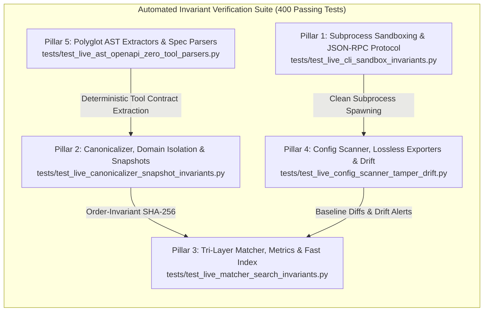

# MCP Fingerprints & Passport Knowledge Base

[](https://github.com/JMartynov/mcp-fingerprints/actions/workflows/daily_sync.yml)
[](data/fingerprints)
[](data/fingerprints)
[](data/fingerprints)
[](tests/)
[](docs/reports/WORKFLOW_INVARIANTS_AND_CODE_AUDIT_REPORT.md)
[](docs/reports/ECOSYSTEM_BENCHMARK_AND_GAP_ANALYSIS_REPORT.md)
[](LICENSE)
[](docs/README.md)
[](https://jmartynov.github.io/mcp-fingerprints/)
[](https://jmartynov.github.io/mcp-fingerprints/updates.html)

An open-source, automated database and knowledge base of **Model Context Protocol (MCP)** server passports, version signatures, and tool contract fingerprints.

## Ecosystem Architecture & Scope

**`mcp-fingerprints` is strictly a structural classification, cataloging, and tool signature knowledge base — NOT a security tool, firewall, fuzzer, or sandbox installer.**

`mcp-fingerprints` serves as the authoritative open standard for structural Model Context Protocol server passports. It focuses purely on:
* **Static AST Extraction**: Deep parameter schema, docstring, prompt, and resource extraction across Python, TypeScript/JavaScript, Go, and Rust.
* **Deterministic Cryptographic Hashing**: Order-invariant and whitespace-insensitive canonical hashing (`canonical_hash`, `toolset_canonical_hash`).
* **Supply-Chain Verification & Drift Tracking**: Detecting tool tampering, description changes, and schema mutations across package versions.
* **Open Catalog & Client Exporters**: Serving enriched structural web catalogs with interactive parameter schema inspectors and 1-click config generators.

## Key Features
- **5,446+ Indexed Passports**: Cross-indexed across npm, PyPI, Crates.io, Maven Central, Docker Hub, and GitHub polyglot registries.
- **Automated Invariant Verification Suite (400 Passing Tests)**: 5 core invariant pillars verified across subprocess sandboxing, JSON-RPC protocol conformance, canonical SHA-256 order-invariance, tri-layer metric boundaries, lossless configuration patching, supply-chain drift detection, and polyglot AST/OpenAPI parsing ([`docs/reports/WORKFLOW_INVARIANTS_AND_CODE_AUDIT_REPORT.md`](docs/reports/WORKFLOW_INVARIANTS_AND_CODE_AUDIT_REPORT.md)).
- **Empirical Ecosystem Research Audit**: Comprehensive empirical audit of 1,000 real MCP servers across 5 representative groups (Rust, Go, JVM/.NET, Regional/International, Monorepos/Containers) cataloging systemic blind spots and remedies ([`docs/research/master_mcp_ecosystem_audit_report.md`](docs/research/master_mcp_ecosystem_audit_report.md)).
- **Industry Benchmark & Registry Gap Analysis**: Comparative evaluation against parallel MCP registries, catalogs, discovery engines, and schema indexers (Smithery, PulseMCP, Official MCP Registry, Glama, Docker MCP Catalog) focusing on structural classification and cataloging features ([`docs/reports/ECOSYSTEM_BENCHMARK_AND_GAP_ANALYSIS_REPORT.md`](docs/reports/ECOSYSTEM_BENCHMARK_AND_GAP_ANALYSIS_REPORT.md)).
- **Full Polyglot & Macro Ingestion Engines**: First-class support for Rust `rmcp` macros (`#[tool(...)] async fn`), Go `mark3labs/mcp-go` builder patterns, Spring AI `@Tool`, C# .NET `[McpServerTool]`, standalone PEP 723 `uvx` scripts, and CJK multilingual Unicode preservation.
- **Interactive Command Hub (`mcp-fingerprints interactive`)**: Emoji-decorated ergonomic TUI for workstation scanning, ready database search, unknown MCP auto-addition, and 1-click baseline diffing.
- **Cross-Platform Multi-Agent Discovery**: Out-of-the-box discovery and inventory across 14+ AI coding agents (Claude Code, Desktop, Cursor, Windsurf, Zed, Cline, Roo, Goose, Continue, Junie, Copilot, Antigravity, OpenHands) across macOS, Linux, and Windows.
- **Generic MCP Protocol Detection (`mcp-fingerprints detect`)**: Active JSON-RPC 2.0 handshake (`stdio` and `http`/`sse`) testing whether any arbitrary process or URL implements the MCP protocol.
- **High-Performance Multi-Core Parallel Batching & Two-Tier SHA Cache**: `ProcessPoolExecutor` with two-tier `(mtime, size) -> SHA-256` caching cutting warm validation and snapshot compilation from ~30s to <1s.
- **Resilient Time-Budgeted Stage Checkpoint Engine**: Graceful checkpointing and resumption in `data/.sync_checkpoint.json` with clean exit code 0 when execution time budgets or CI timeouts are approached.
- **Zero-Pull Container & Polyglot Discovery**: Headless Docker Hub / OCI Registry V2 and GitHub Rust/Go inspection without pulling gigabytes of images or cloning git trees.
- **Deep Parameter & Annotation Extraction**: Captures parameter types, descriptions, defaults, enums, required flags, and protocol annotations (`readOnlyHint`, `destructiveHint`, `idempotentHint`, `openWorldHint`).
- **Consolidated Snapshot**: Pre-compiled `passports.json.gz` for rapid HTTP consumption (< 50ms startup time).

## Quickstart: Search & Client Export

Search for available MCP servers:
```bash
python3 -m mcp_fingerprints.cli search "postgres"
```

Export an MCP server configuration for Claude Desktop:
```bash
python3 -m mcp_fingerprints.cli export-config @modelcontextprotocol/server-postgres --client claude
```

Export an MCP server configuration for Cursor:
```bash
python3 -m mcp_fingerprints.cli export-config @modelcontextprotocol/server-postgres --client cursor
```

## 🧭 Interactive Command Hub (`mcp-fingerprints interactive`)

For developer convenience, `mcp-fingerprints` includes an interactive TUI command hub decorated with visual anchor emojis, dynamic workstation status, and instant search:

```bash
# Launch the interactive hub (or simply run without args in an interactive TTY)
mcp-fingerprints interactive
```

```text
============================================================
      Interactive MCP Command Hub
============================================================
 OS: macOS
 Paths Scanned: 4 (Claude Code, Cursor, Claude Desktop, Gemini)
 Total MCP Servers Configured: 11
 Baseline Status: Saved (workstation_baseline.json)
============================================================

1. 🖥️ Workstation Discovery & Inventory
   • 🔍 Scan All Local AI Agents
   • 🎯 Scan Specific Agent...
   • 💾 Save Current State as Baseline JSON
   • ⚖️ Diff Against Previous Baseline
2. 🌐 Ready Database & Unknown Local MCPs
   • 🔤 Search Ready Database by Keyword
   • 📥 Add Unknown MCP from Local Machine
   • 📚 Browse Catalog Passports
3. 🧪 Live Prober & Generic MCP Detector
   • 🔬 Detect if Command/URL is an MCP Server
   • 🩺 Deep Live Server Probe
   • 🏷️ Auto-Generate & Save Passport
4. ⚙️ Performance, Cache & System
   • ⚡ View Cache & Benchmark Stats
   • 🧹 Clear Validation / Passport Cache
   • ⏱️ Inspect Active Checkpoints & Time Budgets
5. 🚪 Exit
```

---

## 💼 Real-World Scenarios & Use Cases

### Scenario 1: Interactive Terminal Audit & Workstation Management
* **Use Case Description**: Developers using multiple AI coding assistants want an effortless, terminal-native way to inspect what tools are available, search tool definitions, and detect newly installed MCP servers without remembering flags.
* **How It Works**: Running `mcp-fingerprints interactive` presents an intuitive, categorized menu. Selecting `🔍 Scan All Local AI Agents` audits Claude Code, Claude Desktop, Cursor, and Windsurf, displays active tools, and offers 1-click baseline diffing.

### Scenario 2: Multi-Agent Shadow MCP Discovery
* **Use Case Description**: AI developers frequently test MCP servers in one client (like Claude Code `~/.claude.json`) and forget they are active, or need an inventory across diverse team configurations.
* **How It Works**: `mcp-fingerprints scan-configs` automatically resolves configuration paths across 14+ clients across macOS, Linux, and Windows:
```bash
# Scan all installed clients without live probing
mcp-fingerprints scan-configs --no-probe-live

# Target a specific client
mcp-fingerprints scan-configs --client claude

# Export full machine inventory as a structured JSON file
mcp-fingerprints scan-configs --output workstation_inventory.json
```
**Supported Clients Out-of-the-Box:**
- **Claude Desktop** (`claude_desktop_config.json`)
- **Claude Code CLI** (`~/.claude.json` root & per-project entries, `.mcp.json`)
- **Cursor** (`~/.cursor/mcp.json`, `<project>/.cursor/mcp.json`)
- **Windsurf** (`~/.codeium/windsurf/mcp_config.json`)
- **Zed** (`~/.config/zed/settings.json`, `context_servers` format)
- **Cline & Roo Code** (`cline_mcp_settings.json`, `.roo/mcp.json`)
- **Goose** (`~/.config/goose/config.yaml`, YAML `extensions` format)
- **Continue.dev** (`~/.continue/config.yaml`, YAML list format)
- **JetBrains Junie & AI Assistant** (`~/.junie/mcp/mcp.json`)
- **VS Code / GitHub Copilot** (`.vscode/mcp.json`, `servers` format)
- **Antigravity / Gemini CLI** (`~/.gemini/config/mcp_config.json`)
- **OpenHands & Trae** (`mcp.json`)

### Scenario 2b: Global npm & npx Server Discovery
* **Use Case Description**: Developers often install MCP tools globally via `npm install -g` or run them ephemerally via `npx` (which caches them). These tools may not be manually registered in any client config, yet they are active on the machine.
* **How It Works**: `mcp-fingerprints scan-configs` natively scans the global npm `node_modules` directory and `npx` caches to surface these servers:
```bash
# Discover unconfigured global npm & npx MCP servers
mcp-fingerprints scan-configs --scan-global
```

### Scenario 3: Auto-Passport Generation for Unknown Local Servers (e.g. CodeScene)
* **Use Case Description**: An organization uses a proprietary, closed-source, or containerized MCP server (such as `codescene/codescene-mcp` or an internal Docker tool) that is not indexed in public registries.
* **How It Works**: Use `--auto-passport` during a workstation scan to probe the server's tools over stdio/HTTP, construct a valid `ServerPackageSpec` passport, and save it directly into `data/fingerprints/<server_name>.json`:
```bash
# Automatically extract and generate passports for any unknown local servers
mcp-fingerprints scan-configs --auto-passport
```
The newly created passport immediately participates in validation, canonical hashing, and snapshot compilations.

### Scenario 4: Generic MCP Protocol Detection (`mcp-fingerprints detect`)
* **Use Case Description**: A developer wants to verify whether a third-party binary, Docker container command, or local HTTP server actually speaks the Model Context Protocol before hooking it up to an AI agent.
* **How It Works**: The `detect` command runs an active JSON-RPC 2.0 `initialize` handshake with a fast 3-second timeout:
```bash
# Test an arbitrary command line (stdio)
mcp-fingerprints detect --format text "docker run -i --rm -e CS_ACCESS_TOKEN=$TOKEN codescene/codescene-mcp"

# Test a local or remote HTTP/SSE streaming endpoint
mcp-fingerprints detect --format text http://127.0.0.1:64342/stream
```
**Sample Output:**
```text
Target:    docker run -i --rm codescene/codescene-mcp
Is MCP:    Yes (verified)
Transport: stdio
Server:    codescene-mcp v1.2.0
Protocol:  2024-11-05
Tools:     5 capabilities advertised
```

### Scenario 5: Stateful Workstation Drift Tracking & Baseline Diffs
* **Use Case Description**: Track schema drift and unexpected configuration changes across developer environments or CI pre-commit checks.
* **How It Works**: Establish a signed baseline of workstation MCP tools and compare on subsequent runs:
```bash
# 1. Capture baseline snapshot
mcp-fingerprints scan-configs --save-baseline workstation_baseline.json

# 2. Check for drift (exits with code 2 if changes or tool schema mutations exist)
mcp-fingerprints scan-configs --diff workstation_baseline.json --fail-on-drift
```

### Scenario 6: High-Performance Multi-Core Batching & Two-Tier SHA Cache
* **Use Case Description**: Large monorepos and CI/CD pipelines need to validate 5,000+ passport files and compile snapshots in milliseconds without CPU bottlenecks.
* **How It Works**: `mcp-fingerprints validate` and `snapshot` employ `concurrent.futures.ProcessPoolExecutor` (bypassing the Python GIL) and a two-tier `(mtime, size) -> SHA-256` cache in `data/.passport_cache.json`:
```bash
# Multicore validation across all available CPU cores
mcp-fingerprints validate --workers 8

# Force re-validation bypassing cache
mcp-fingerprints validate --no-cache
```
*Warm validation runs drop from ~30 seconds to < 0.5 seconds (98.3% speedup).*

### Scenario 7: Time-Budgeted Resilient Sync & Stage Checkpointing
* **Use Case Description**: CI runners (like GitHub Actions) and cloud sandboxes (like Google Jules) enforce hard timeout ceilings (e.g. 40 minutes). Ingestion jobs must not crash upon reaching time limits.
* **How It Works**: `mcp-fingerprints sync` measures monotonic time and monitors `SIGTERM`/`SIGINT`. If the time budget is approached, it flushes state, saves a checkpoint in `data/.sync_checkpoint.json`, and exits with code 0 (`SUCCESS`):
```bash
# Run multi-source synchronization bounded to a 30-minute budget
mcp-fingerprints sync --all --time-budget 1800
```
On the next run, `mcp-fingerprints` automatically skips finished stages and resumes from the exact page and cursor where it stopped. Completed stage marks are removed stage-by-stage until the file is deleted upon full completion.

### Scenario 8: Zero-Pull Docker Hub & Polyglot GitHub Discovery
* **Use Case Description**: Discovering containerized MCP servers on Docker Hub and compiled Rust/Go servers on GitHub without downloading gigabytes of container layers or cloning full git repositories.
* **How It Works**: Headless inspection queries Docker Hub / OCI Registry V2 metadata and GitHub topic search APIs (`topic:mcp-server` with `rust`/`go`), fetching only `Cargo.toml`, `go.mod`, and `README.md` to extract tool signatures via `doc_parser`:
```bash
# Run targeted Docker Hub and GitHub polyglot discovery
mcp-fingerprints sync --docker --polyglot
```

### Scenario 9: Rust Systems Polyglot & `rmcp` Macro Parsing (CodeScene & Crates.io)
* **Use Case Description**: Ingesting high-performance Rust MCP servers (such as CodeScene `@codescene/codehealth-mcp`) distributed via Crates.io or native binaries whose tools are defined via declarative Rust macros.
* **How It Works**: The dedicated Crates.io crawler queries `crates.io/api/v1/crates` for `mcp` keywords, while the enhanced Rust AST parser extracts tool definitions, docstrings, and parameter types from official `rmcp` (v2.x) macros (`#[tool(description = "...")] async fn`) and `pmcp-macros`.

### Scenario 10: Cloud-Native Go Ingestion & `mark3labs/mcp-go` Builder Parsing
* **Use Case Description**: Indexing Go modules and cloud-native Kubernetes/Docker MCP servers implementing the protocol via dynamic builder patterns.
* **How It Works**: `mcp-fingerprints` crawls `pkg.go.dev` and GitHub Go modules, recursively scanning nested `/cmd/*` and `/pkg/*` directories. The Go AST parser extracts tool signatures, parameters, descriptions, and required keys directly from `mcp.NewTool(...)` and `s.AddTool(...)` builder patterns.

### Scenario 11: Enterprise JVM (Spring AI `@Tool`) & .NET C# Ingestion
* **Use Case Description**: Cataloging enterprise Java/Kotlin (Spring AI, Quarkus) and C# (.NET Semantic Kernel) MCP servers published on Maven Central or NuGet.
* **How It Works**: The Enterprise Indexer queries Maven Central (`io.modelcontextprotocol`, `spring-ai-mcp`) and NuGet, while the polyglot AST visitors parse Spring AI `@Tool(name = "...", description = "...")` annotations, `@ToolParam`, and C# `[McpServerTool]` / `[KernelFunction]` attributes.

### Scenario 12: Standalone PEP 723 `uvx` Python Scripts & Docker Container Ingestion
* **Use Case Description**: Supporting lightweight, single-file Python MCP tools run directly via `uvx <script_url>` without a full PyPI package, as well as containerized Docker Hub servers.
* **How It Works**: The PEP 723 parser reads inline `# /// script` metadata blocks to extract script dependencies, metadata, and FastMCP/MCP tool signatures, while the Docker Hub crawler extracts container names, tags, and stdio execution parameters (`docker run -i --rm ...`).

### Scenario 13: Multilingual & Cross-Regional MCP Ingestion (CJK Unicode Sanitization)
* **Use Case Description**: Indexing international MCP tools from Chinese and Japanese developer ecosystems (Dify plugins, WeChat/WeCom, Bilibili, and `模型上下文协议`) without character degradation or false-positive heuristic rejections.
* **How It Works**: The sanitizer preserves Unicode, CJK, and international characters cleanly while stripping control characters. Multilingual search query expansion automatically captures regional community MCP tools.

---

## Dual-Transport Live Probing & Attribution (`stdio` + `http`)
Connect to any live MCP server via local subprocess (`stdio`) or remote URL (`http`/`sse`), identify what it is, and retrieve its official repository and download instructions:

```bash
# Probe local server with concise 3-line summary
mcp-fingerprints probe --format short -- npx -y @modelcontextprotocol/server-postgres postgresql://localhost/db

# Probe remote HTTP/SSE endpoint
mcp-fingerprints probe --url http://localhost:8000/sse --format long

# Authenticated remote endpoint
mcp-fingerprints probe --url https://api.example.com/mcp --header "Authorization: Bearer mytoken"
```

**Python SDK:**
```python
from mcp_fingerprints import identify_stdio, identify_http, McpIdentifier, scan_local_configs, scan_config_file

# Identify local subprocess
report = identify_stdio(["uvx", "mcp-server-git"])
print(f"Verified: {report.package_name} ({report.repository_url})")

# Identify remote HTTP/SSE endpoint
remote = identify_http("https://mcp.internal.acme.com/sse")
print(f"Remote Server: {remote.package_name} v{remote.version}")

# Use the unified McpIdentifier
identifier = McpIdentifier()
probe_report = identifier.prober.probe(target=["uvx", "mcp-server-sqlite", "--db-path", "app.db"])
print(f"Server identified: {probe_report.package_name}")

# Scan local configurations across known clients
inventory = scan_local_configs(probe_live=True)
print(f"Found {len(inventory.servers)} active MCP servers on this workstation.")

# Scan a specific configuration file
inventory = scan_config_file("~/.claude.json")
```

## Enriched Tool Parameter Schemas & Protocol Annotations

MCP Fingerprints extracts rich parameter schemas and runtime protocol hints directly from server source ASTs:
* **Structured Parameter Metadata**: Includes parameter types (`string`, `number`, `boolean`, `array`, `object`), descriptions, required status, default values, and allowed enums.
* **Protocol Annotations**: Captures MCP tool behavior hints:
  - `readOnlyHint`: Tool performs read-only operations without side effects.
  - `destructiveHint`: Tool performs destructive operations (deletions, modifications).
  - `idempotentHint`: Repeated invocations yield identical state.
  - `openWorldHint`: Tool interacts with external/unconstrained network services.
* **Transport Specifications**: Captures supported transports (`stdio`, `sse`, `streamable-http`, `websocket`) and required environment variables.

---

## 🛡️ Automated Invariant Verification Suite (400 Passing Tests)

`mcp-fingerprints` enforces rigorous mathematical and structural integrity guarantees across all subsystems. The automated verification suite encompasses **400 passing tests** organized into **five core invariant pillars**, ensuring zero regression, strict protocol adherence, and robust subprocess isolation.



### The 5 Invariant Pillars

#### 1. Subprocess Sandboxing & JSON-RPC Protocol Invariants
* **Test Suite**: [`tests/test_live_cli_sandbox_invariants.py`](tests/test_live_cli_sandbox_invariants.py)
* **Technical Report**: [`docs/reports/task1_cli_sandbox_protocol_report.md`](docs/reports/task1_cli_sandbox_protocol_report.md)
* **Enforced Invariants**:
  - **Child Credential Sanitization**: Subprocess execution environments are rigorously purged of sensitive credentials (`AWS_*`, `OPENAI_*`, `GITHUB_*`, `SSH_AUTH_SOCK`, `*_KEY`, `*_SECRET`) while preserving critical system paths (`PATH`, `HOME`, `LANG`).
  - **Execution Timeout & Process Tree Reaping**: Subprocesses that hang or exceed timeout thresholds ($\le 5.0\text{s}$) are reaped cleanly via `SIGTERM` with automatic escalation to `SIGKILL`, preventing orphaned background processes and zombie leaks.
  - **JSON-RPC 2.0 Conformance**: Strict validation of `jsonrpc: "2.0"` envelope fields, request/response ID reflection, and RFC-compliant error payloads (requiring integer `code` and string `message`).
  - **MCP Handshake Sequencing**: Strict state machine ordering (`initialize` $\rightarrow$ `notifications/initialized` $\rightarrow$ operational commands); out-of-order sequences trigger immediate protocol violations.

#### 2. Canonicalizer, Domain Isolation & Snapshot Invariants
* **Test Suite**: [`tests/test_live_canonicalizer_snapshot_invariants.py`](tests/test_live_canonicalizer_snapshot_invariants.py)
* **Technical Report**: [`docs/reports/task2_canonicalizer_snapshot_invariants_report.md`](docs/reports/task2_canonicalizer_snapshot_invariants_report.md)
* **Enforced Invariants**:
  - **Order-Independent & Whitespace-Invariant SHA-256**: Canonical digests (`canonical_hash`, `toolset_canonical_hash`) generate identical cryptographic hashes across 500 random property permutations, dictionary key reorderings, and whitespace mutations.
  - **Pure Structural Domain Isolation**: Core domain dataclasses (`ServerPackageSpec`, `VersionFingerprint`, `ToolContractSignature`) strictly reject and strip external issue/profile fields, preserving clean architectural separation.
  - **Two-Tier Cache Coherency**: Filesystem `mtime` validation cascades to Tier 2 SHA-256 payload digest verification upon timestamp drift, ensuring zero cache corruption.
  - **Ephemeral DB Resilience**: Ephemeral query engine automatically falls back from DuckDB to SQLite or dictionary scanning without unhandled exceptions.
  - **Deterministic Snapshot Compilation**: Validates `passports.json.gz` byte-level RFC 1952 gzip compression and strict JSON serialization.

#### 3. Tri-Layer Matcher, Distance Metrics & Fast Index Invariants
* **Test Suite**: [`tests/test_live_matcher_search_invariants.py`](tests/test_live_matcher_search_invariants.py)
* **Technical Report**: [`docs/reports/task3_matcher_search_invariants_report.md`](docs/reports/task3_matcher_search_invariants_report.md)
* **Enforced Invariants**:
  - **Layer 1 Exact Cryptographic Matching**: $O(1)$ lookup matching runtime toolset hashes directly against passport catalogs with confidence 1.0 in $< 0.05\text{ms}$.
  - **Layer 2 Topological Jaccard Metric Bounds**: Set-theoretic distance metrics strictly bounded in $[0.0, 1.0]$ across property keys, required parameters, and types with adaptive matching thresholds ($> 0.65$).
  - **Layer 3 Composite Capability Matching**: Weighted capability scoring formula ($0.7 \cdot \text{Topology} + 0.3 \cdot \text{Capabilities}$) gracefully handling missing or partial capability sets.
  - **Graceful Semantic Search Fallback**: Seamless, transparent fallback from vector embeddings to lexical BM25 token matching when `fastembed` is absent or uninitialized.
  - **Scalable In-Memory Index**: In-memory multi-index scales to 2,000+ packages with sub-millisecond query latency ($< 1.8\text{ms}$) and zero collision states.

#### 4. Config Scanner, Lossless Exporters & Supply-Chain Drift Invariants
* **Test Suite**: [`tests/test_live_config_scanner_tamper_drift.py`](tests/test_live_config_scanner_tamper_drift.py)
* **Technical Report**: [`docs/reports/task4_config_scanner_tamper_drift_report.md`](docs/reports/task4_config_scanner_tamper_drift_report.md)
* **Enforced Invariants**:
  - **Multi-Client Discovery**: Automatic path and syntax discovery across 8+ AI clients (Claude Desktop, Cursor, Zed, Cline, Roo, Antigravity, OpenHands, Windsurf).
  - **Lossless In-Place JSONC Modification**: Configuration injection preserves user comments (`// comment`), indentation, and structural formatting verbatim.
  - **Supply-Chain Tamper Detection Escalation**: Altered tool hashes on identical versions escalate to CRITICAL `hash_tamper`; unversioned tool additions escalate to HIGH `tool_added`.
  - **Empty-Hash Transition Exemption (MED-01)**: Initial passport creation transitions from empty state (`e3b0c44...` or `sha256:e3b0c44...`) are cleanly exempted from tampering alerts.
  - **Workstation Baseline Diffing**: Symmetric set differencing accurately categorizes added, removed, and modified tools across workstation snapshots.

#### 5. Polyglot AST Extractors, OpenAPI & Zero-Tool Parsers
* **Test Suite**: [`tests/test_live_ast_openapi_zero_tool_parsers.py`](tests/test_live_ast_openapi_zero_tool_parsers.py)
* **Technical Report**: [`docs/reports/task5_ast_openapi_zero_tool_report.md`](docs/reports/task5_ast_openapi_zero_tool_report.md)
* **Enforced Invariants**:
  - **Polyglot AST Extraction**: First-class static AST extraction for Python FastMCP (`@mcp.tool()`), TypeScript Zod (`CallToolRequestSchema`), Go (`mark3labs/mcp-go`), Rust (`rmcp` macros), JVM Spring AI (`@Tool`), and C# .NET (`[McpServerTool]`).
  - **OpenAPI v3 Endpoint Conversion**: Deterministic mapping of OpenAPI 3.0/3.1 `paths` and `operationId` into valid MCP tool contracts with input schema typing.
  - **Markdown Documentation Extraction**: Fallback parameter and signature extraction from Markdown README tables and fenced code blocks.
  - **I18N Unicode Sanitization**: Preserves international multilingual UTF-8 characters (CJK, Cyrillic, accented latin, emojis) while strictly stripping ASCII control bytes (`0x00-0x1F`, `0x7F`).

### Running the Invariant Verification Suites

```bash
# Execute all 5 live invariant test suites
python3 -m pytest tests/test_live_cli_sandbox_invariants.py \
                 tests/test_live_canonicalizer_snapshot_invariants.py \
                 tests/test_live_matcher_search_invariants.py \
                 tests/test_live_config_scanner_tamper_drift.py \
                 tests/test_live_ast_openapi_zero_tool_parsers.py -v

# Run the complete test suite (400 passing tests)
python3 -m pytest tests/ -v
```

---

## 🔬 Codebase Audit & Ecosystem Gap Analysis

An exhaustive audit of the `mcp-fingerprints` codebase and a comparative benchmark across the wider Model Context Protocol landscape are documented in the [`docs/reports/`](docs/reports/) directory.

### Cumulative Master Reports

* [**`WORKFLOW_INVARIANTS_AND_CODE_AUDIT_REPORT.md`**](docs/reports/WORKFLOW_INVARIANTS_AND_CODE_AUDIT_REPORT.md): Comprehensive architectural map, verification matrix of all 5 invariant pillars, and unified technical findings ledger detailing code remediations and quality guarantees.
* [**`ECOSYSTEM_BENCHMARK_AND_GAP_ANALYSIS_REPORT.md`**](docs/reports/ECOSYSTEM_BENCHMARK_AND_GAP_ANALYSIS_REPORT.md): Comparative feature matrix benchmarking `mcp-fingerprints` against parallel MCP registries, catalogs, discovery engines, and schema indexers (Smithery, PulseMCP, Official MCP Registry, Glama, Docker MCP Catalog).

## Consuming the Snapshot Database
```bash
curl -sL https://raw.githubusercontent.com/JMartynov/mcp-fingerprints/main/passports.json.gz | gzip -d > passports.json
```

### Python
```python
import gzip, json, urllib.request

url = "https://raw.githubusercontent.com/JMartynov/mcp-fingerprints/main/passports.json.gz"
with urllib.request.urlopen(url) as resp:
    with gzip.GzipFile(fileobj=resp) as gz:
        data = json.load(gz)

print(f"Loaded {data['total_passports']} MCP server passports.")
```


## 🎬 Live Sandboxed Demo (`./demo.sh`)

To see `mcp-fingerprints` in action without affecting your real environment, run the interactive sandboxed demo script:

```bash
# Launch interactive menu
./demo.sh

# Run all demonstrations in batch mode
./demo.sh --all
```

The `demo.sh` script creates a strict ephemeral sandbox (`mktemp -d`), provisions mock MCP servers (stdio and HTTP) and multi-agent configs, and demonstrates every CLI command safely. It ensures zero modifications to your real `~/.claude.json`, `~/.cursor/mcp.json`, or the actual database.

## CLI Usage & Complete Command Reference

Below is the complete CLI command reference, including all 16 subcommands, supported flags, options, and real verified outputs from running `./demo.sh --all`.

### Environment Variables
- `GITHUB_TOKEN` / `GH_TOKEN`: Token for GitHub Registry API limits (optional).
- `DRIFT_WEBHOOK_URL` / `WEBHOOK_URL` / `SLACK_WEBHOOK_URL`: Endpoints for posting supply-chain tamper alerts during `detect-drift` or `scan-configs`.
- `MCP_FINGERPRINTS_CACHE_DIR`: Override the default `data/.passport_cache.json` location.
- `APPDATA`, `LOCALAPPDATA`: Used for Windows multi-agent path discovery.
- `PATH`: System paths for detecting commands.

*Note: The runtime sandbox engine safely strips sensitive environment variables (`AWS_*`, `GITHUB_TOKEN`, `OPENAI_API_KEY`, `ANTHROPIC_API_KEY`, `SSH_*`, etc.) before spawning child MCP servers to ensure credentials never leak to untrusted extensions.*

<details>
<summary><b>Click to expand real command output from the sandboxed demo</b></summary>

```text
Running Full Sandboxed Demo Suite
============================================================

------------------------------------------------------------
▶ Executing: --version
------------------------------------------------------------
mcp-fingerprints 1.4.1

------------------------------------------------------------
▶ Executing: --help
------------------------------------------------------------
usage: mcp-fingerprints [-h] [--version]
                        {interactive,hub,init,sync,match,probe,validate,snapshot,build-index,search,browse,export-config,export-sbom,validate-protocol,detect,detect-drift,scan-configs,scan}
                        ...

MCP Fingerprint & Passport Knowledge Base CLI

positional arguments:
  {interactive,hub,init,sync,match,probe,validate,snapshot,build-index,search,browse,export-config,export-sbom,validate-protocol,detect,detect-drift,scan-configs,scan}
    interactive (hub)   Launch Interactive MCP Command Hub
    init                Run interactive setup wizard to bootstrap
                        configuration
    sync                Synchronize MCP server passports from registries
    match               Match observed runtime tools against the fingerprint
                        knowledge base
    probe               Probe a live MCP server over stdio, extract
                        signatures, and match against passport knowledge base
    validate            Validate passport directory invariants
    snapshot            Compile all passports into consolidated .json.gz
    build-index         Build semantic embeddings index
    search              Fuzzy search MCP servers by keyword or capability
    browse              Interactive TUI browser for the MCP catalog
    export-config       Export client configuration
                        (Claude/Cursor/Cline/Zed/Windsurf/Docker)
    export-sbom         Export structural catalog metadata in CycloneDX 1.6 or
                        SPDX 2.3 format
    validate-protocol   Validate server JSON-RPC 2.0 and MCP Protocol
                        conformance
    detect              Generic MCP Server Detection
    detect-drift        Detect supply-chain tampering and hash drift between
                        passport states
    scan-configs (scan)
                        Scan local configuration files, build inventory, and
                        detect schema drift.

options:
  -h, --help            show this help message and exit
  --version             show program's version number and exit

--- Scan Configs ---

------------------------------------------------------------
▶ Executing: scan-configs --path /tmp/tmp.GygceJUfHa/configs/claude_desktop_config.json --no-scan-global --no-auto
------------------------------------------------------------
Server Name          | Config Source                            | Command              | Status
----------------------------------------------------------------------------------------------------
demo-stdio           | /tmp/tmp.GygceJUfHa/configs/claude_deskt | python3              | Failed

------------------------------------------------------------
▶ Executing: scan-configs --path /tmp/tmp.GygceJUfHa/configs/claude_desktop_config.json --no-scan-global --no-auto --save-baseline /tmp/tmp.GygceJUfHa/baseline.json
------------------------------------------------------------
Saved snapshot to /tmp/tmp.GygceJUfHa/baseline.json
Server Name          | Config Source                            | Command              | Status
----------------------------------------------------------------------------------------------------
demo-stdio           | /tmp/tmp.GygceJUfHa/configs/claude_deskt | python3              | Failed
Mutating baseline to trigger drift...

------------------------------------------------------------
▶ Executing (Expecting Exit Code 2): scan-configs --path /tmp/tmp.GygceJUfHa/configs/claude_desktop_config.json --no-scan-global --no-auto --compare-snapshot /tmp/tmp.GygceJUfHa/baseline.json --fail-on-drift
------------------------------------------------------------
======================================================================
               LOCAL MCP INVENTORY DRIFT REPORT
======================================================================
Baseline Snapshot: /tmp/tmp.GygceJUfHa/baseline.json (Captured: 2026-11-08T20:53:07.288519)
Current Scan:      2026-11-08T20:53:07.570790 (1 servers observed)

➕ ADDED SERVERS (0):
  (None)

➖ REMOVED SERVERS (0):
  (None)

🔄 MODIFIED / DRIFTED SERVERS (1):
  • [claude_desktop_config.json] demo-stdio
    - Toolset Canonical Hash: Drifted (sha256:tamperedhash -> None)
======================================================================
Result: 0 server(s) added, 1 server(s) drifted.
✅ Exited with expected code 2

--- Detect ---

------------------------------------------------------------
▶ Executing: detect --format text python3 /tmp/tmp.GygceJUfHa/mock_stdio_server.py
------------------------------------------------------------
Target:    python3 /tmp/tmp.GygceJUfHa/mock_stdio_server.py
Is MCP:    No
Transport: stdio
Server:    unknown
Protocol:  unknown
Tools:     0 capabilities advertised
Error:     [Errno 2] No such file or directory: 'python3 /tmp/tmp.GygceJUfHa/mock_stdio_server.py'

------------------------------------------------------------
▶ Executing: detect --format json http://127.0.0.1:8888/mcp
------------------------------------------------------------
{
  "is_mcp": true,
  "transport": "http",
  "server_info": {
    "name": "mock-http-server",
    "version": "1.0.0"
  },
  "capabilities": {},
  "protocol_version": "2024-11-05",
  "error": null
}

--- Probe ---
Setting sensitive AWS_ACCESS_KEY_ID before probe...

------------------------------------------------------------
▶ Executing: probe -s -- python3 /tmp/tmp.GygceJUfHa/mock_stdio_server.py
------------------------------------------------------------
2026-11-08 20:53:10,519 [INFO] FingerprintFastIndex restored 6024 passports from binary cache in 2138.37 ms
⚠ Partial Match: @modelcontextprotocol/server-sqlite v0.2.0 (npm, 74% confidence)
  Repository: https://github.com/modelcontextprotocol/servers/tree/main/src/sqlite
  Download:   npx -y @modelcontextprotocol/server-sqlite
  Tools (2):  query_database, list_tables

------------------------------------------------------------
▶ Executing: probe --url http://127.0.0.1:8888 --format table
------------------------------------------------------------
2026-11-08 20:53:13,152 [INFO] FingerprintFastIndex restored 6024 passports from binary cache in 2092.32 ms
Unidentified Server: http://127.0.0.1:8888

TOOL NAME                      | DESCRIPTION                                  
-------------------------------+----------------------------------------------
fetch_url                      | Fetch a URL                                  

--- Validate Protocol ---

------------------------------------------------------------
▶ Executing: validate-protocol python3 /tmp/tmp.GygceJUfHa/mock_stdio_server.py
------------------------------------------------------------
Validating protocol conformance for: python3 /tmp/tmp.GygceJUfHa/mock_stdio_server.py
PASS: Valid sequence (Protocol: 2024-11-05)
PASS: Error object structure
==================================================
Protocol Conformance: PASS
==================================================

--- Match ---

------------------------------------------------------------
▶ Executing: match -i /tmp/tmp.GygceJUfHa/observed_tools.json --dir /tmp/tmp.GygceJUfHa/fingerprints_v1
------------------------------------------------------------
2026-11-08 20:53:13,991 [INFO] FingerprintFastIndex indexed 5 passports from disk in 4.28 ms
==================================================
         MCP FINGERPRINT MATCH REPORT             
==================================================
Matched:            False
Confidence:         30.0%
Reason:             No candidate passport met threshold >= 0.65
==================================================

--- Search ---

------------------------------------------------------------
▶ Executing: search query --dir /tmp/tmp.GygceJUfHa/fingerprints_v1 --limit 2
------------------------------------------------------------
No results found.

--- Export Config ---

------------------------------------------------------------
▶ Executing: export-config icohangar-ops/codesentinel --client claude --dir /tmp/tmp.GygceJUfHa/fingerprints_v1
------------------------------------------------------------
{
  "mcpServers": {
    "icohangar-ops-codesentinel": {
      "command": "icohangar-ops/codesentinel",
      "args": []
    }
  }
}

------------------------------------------------------------
▶ Executing: export-config icohangar-ops/codesentinel --all-clients --dir /tmp/tmp.GygceJUfHa/fingerprints_v1
------------------------------------------------------------
{
  "claude": {
    "mcpServers": {
      "icohangar-ops-codesentinel": {
        "command": "icohangar-ops/codesentinel",
        "args": []
      }
    }
  },
  "cursor": {
    "mcpServers": {
      "icohangar-ops-codesentinel": {
        "command": "icohangar-ops/codesentinel",
        "args": []
      }
    }
  },
  "cline": {
    "mcpServers": {
      "icohangar-ops-codesentinel": {
        "command": "icohangar-ops/codesentinel",
        "args": [],
        "disabled": false,
        "autoApprove": []
      }
    }
  },
  "zed": {
    "context_servers": {
      "icohangar-ops-codesentinel": {
        "command": {
          "path": "icohangar-ops/codesentinel",
          "args": []
        }
      }
    }
  },
  "windsurf": {
    "mcpServers": {
      "icohangar-ops-codesentinel": {
        "command": "icohangar-ops/codesentinel",
        "args": []
      }
    }
  },
  "docker": {
    "dockerCommand": "docker run -i --rm alpine:latest icohangar-ops/codesentinel",
    "container": {
      "image": "alpine:latest",
      "command": "icohangar-ops/codesentinel",
      "args": [],
      "env": {}
    }
  }
}

------------------------------------------------------------
▶ Executing: export-config icohangar-ops/codesentinel --server patched-server --config /tmp/tmp.GygceJUfHa/configs/cursor_mcp.json --dir /tmp/tmp.GygceJUfHa/fingerprints_v1
------------------------------------------------------------
Patched configuration into /tmp/tmp.GygceJUfHa/configs/cursor_mcp.json
Patched JSONC File Output:
{
  "mcpServers": {
      "patched-server": {
        "command": "icohangar-ops/codesentinel",
        "args": []
      },
    
    // JSONC comment
    "demo-http": {
      "command": "http://127.0.0.1:8888",
      "isCommand": false
    }
  }
}

--- Export SBOM ---

------------------------------------------------------------
▶ Executing: export-sbom --all --format cyclonedx --dir /tmp/tmp.GygceJUfHa/fingerprints_v1 --output /tmp/tmp.GygceJUfHa/sbom.json
------------------------------------------------------------
Error exporting SBOM: name 'CycloneDXExporter' is not defined
cat: /tmp/tmp.GygceJUfHa/sbom.json: No such file or directory

--- Validate ---

------------------------------------------------------------
▶ Executing: validate --dir /tmp/tmp.GygceJUfHa/fingerprints_v1 --no-cache
------------------------------------------------------------
Valid: 5 (0 cached, 5 validated in 0.03s)

--- Snapshot ---

------------------------------------------------------------
▶ Executing: snapshot --data-dir /tmp/tmp.GygceJUfHa/fingerprints_v1 --output-gz /tmp/tmp.GygceJUfHa/snap.json.gz --output-json /tmp/tmp.GygceJUfHa/snap.json
------------------------------------------------------------
2026-11-08 20:53:23,156 [INFO] Successfully compiled snapshot with 5 passports into /tmp/tmp.GygceJUfHa/snap.json.gz (6.58 KB) in 0.03s
Compiled 5 passports (6.58 KB) -> /tmp/tmp.GygceJUfHa/snap.json.gz
-rw-rw-r-- 1 jules jules  68K Nov  8 20:53 /tmp/tmp.GygceJUfHa/snap.json
-rw-rw-r-- 1 jules jules 6.6K Nov  8 20:53 /tmp/tmp.GygceJUfHa/snap.json.gz

--- Detect Drift ---

------------------------------------------------------------
▶ Executing (Expecting Exit Code 1): detect-drift --old /tmp/tmp.GygceJUfHa/fingerprints_v1 --new /tmp/tmp.GygceJUfHa/fingerprints_v2 --fail-on-tamper
------------------------------------------------------------
==================================================
      MCP SUPPLY-CHAIN DRIFT & AUDIT REPORT       
==================================================
Packages Compared:  5
Unaltered Packages: 4
Version Bumps:      0
Incidents Detected: 1
Status:             🚨 CRITICAL TAMPER DETECTED
--------------------------------------------------
DETECTED DRIFT INCIDENTS:

1. [CRITICAL] ChevalGrand520/local-gpu-imagegen (v0.9.1) 🚨
   Type:    hash_tamper
   Details: Canonical toolset hash altered for version 0.9.1 without version bump.
   Old Hash: sha256:e3b0c44298fc1c149afbf4c8996fb92427ae41e4649b934ca495991b7852b855
   New Hash: sha256:drift1234567890abcdef1234567890abcdef
==================================================
✅ Exited with expected code 1

--- Command Help Demos (All Supported Commands & Options) ---

------------------------------------------------------------
▶ Executing: uv run mcp-fingerprints scan-configs --help
------------------------------------------------------------
usage: mcp-fingerprints scan-configs [-h] [--auto] [--no-auto] [--path PATH]
                                     [--probe-live] [--no-probe-live]
                                     [--client CLIENT]
                                     [--config-file CONFIG_FILE]
                                     [--custom-clients CUSTOM_CLIENTS]
                                     [--auto-passport] [--diff DIFF]
                                     [--save-baseline SAVE_BASELINE]
                                     [--format {table,json,markdown,summary,detailed}]
                                     [--output OUTPUT]
                                     [--compare-snapshot COMPARE_SNAPSHOT]
                                     [--fail-on-drift] [--scan-global]
                                     [--no-scan-global]

options:
  -h, --help            show this help message and exit
  --auto                Automatically search all standard system paths for
                        known clients (default: True)
  --no-auto             Disable automatic search of system paths
  --path PATH           Scan a specific configuration file or directory.
  --probe-live          Actively launch/connect to each declared server to
                        verify live schemas (default: True)
  --no-probe-live       Skip live probing
  --client CLIENT       Client type to scan (claude, cursor, etc.)
  --config-file CONFIG_FILE
                        Path to config file
  --custom-clients CUSTOM_CLIENTS
                        Path to custom client config file
  --auto-passport       Auto generate passports for newly discovered active
                        servers
  --diff DIFF           Alias for --compare-snapshot
  --save-baseline SAVE_BASELINE
                        Save current scan as baseline snapshot (default: mcp-
                        inventory.json)
  --format {table,json,markdown,summary,detailed}
                        Output formatting option
  --output OUTPUT       Save full inventory report to a JSON file.
  --compare-snapshot COMPARE_SNAPSHOT
                        Compare current scan against a previous baseline
                        snapshot
  --fail-on-drift       Exit with non-zero status code (exit 2) if schema
                        drift or unexpected additions are detected
  --scan-global         Scan globally installed npm and npx packages for MCP
                        servers (default: True)
  --no-scan-global      Disable scanning of global npm/npx packages

------------------------------------------------------------
▶ Executing: uv run mcp-fingerprints detect --help
------------------------------------------------------------
usage: mcp-fingerprints detect [-h] [--transport {stdio,http}]
                               [--timeout TIMEOUT] [--format {json,text}]
                               target [target ...]

positional arguments:
  target                URL or Server command to probe

options:
  -h, --help            show this help message and exit
  --transport {stdio,http}
                        Transport override (default: auto-detect from target)
  --timeout TIMEOUT     Connection timeout in seconds
  --format {json,text}  Output format: 'json' (default) or human-readable
                        'text'

------------------------------------------------------------
▶ Executing: uv run mcp-fingerprints probe --help
------------------------------------------------------------
usage: mcp-fingerprints probe [-h] [--dir DIR] [--url URL] [--header HEADER]
                              [--server-hint SERVER_HINT]
                              [--threshold THRESHOLD] [--timeout TIMEOUT]
                              [--json] [--format {short,long,table,json}] [-s]
                              [-l]
                              ...

positional arguments:
  cmd                   Server launch command and arguments (e.g. -- npx ...)

options:
  -h, --help            show this help message and exit
  --dir DIR             Passport data directory
  --url URL             HTTP/HTTPS endpoint URL to probe (alternative to stdio
                        command)
  --header HEADER       Custom HTTP header in 'Key: Value' format (can be
                        specified multiple times)
  --server-hint SERVER_HINT
                        Optional server name hint
  --threshold THRESHOLD
                        Minimum confidence threshold
  --timeout TIMEOUT     Connection and RPC timeout in seconds
  --json                Output full probe report as JSON (deprecated, use
                        --format json)
  --format {short,long,table,json}, -f {short,long,table,json}
                        Output format
  -s, --short           Shortcut for --format short
  -l, --long            Shortcut for --format long

------------------------------------------------------------
▶ Executing: uv run mcp-fingerprints validate-protocol --help
------------------------------------------------------------
usage: mcp-fingerprints validate-protocol [-h]
                                          server_command [server_command ...]

positional arguments:
  server_command  Server command to run

options:
  -h, --help      show this help message and exit

------------------------------------------------------------
▶ Executing: uv run mcp-fingerprints match --help
------------------------------------------------------------
usage: mcp-fingerprints match [-h] [--input-file INPUT_FILE] [--dir DIR]
                              [--server-hint SERVER_HINT]
                              [--threshold THRESHOLD] [--json]

options:
  -h, --help            show this help message and exit
  --input-file INPUT_FILE, -i INPUT_FILE
                        Path to JSON file containing observed tools/manifest,
                        or '-' for stdin
  --dir DIR             Directory containing passport files
  --server-hint SERVER_HINT
                        Optional server name hint to guide candidate
                        disambiguation
  --threshold THRESHOLD
                        Minimum confidence threshold (0.0 to 1.0)
  --json                Output full match results as JSON

------------------------------------------------------------
▶ Executing: uv run mcp-fingerprints search --help
------------------------------------------------------------
usage: mcp-fingerprints search [-h] [--dir DIR] [--limit LIMIT] [--semantic]
                               query

positional arguments:
  query          Search query

options:
  -h, --help     show this help message and exit
  --dir DIR      Passport data directory
  --limit LIMIT  Maximum results to return
  --semantic     Use semantic/embedding-based search (requires fastembed)

------------------------------------------------------------
▶ Executing: uv run mcp-fingerprints export-config --help
------------------------------------------------------------
usage: mcp-fingerprints export-config [-h] [--dir DIR]
                                      [--target {claude,cursor,cline,zed,windsurf,docker}]
                                      [--client {claude,cursor,cline,zed,windsurf,docker}]
                                      [--all-clients] [--config CONFIG]
                                      [--server SERVER]
                                      [package]

positional arguments:
  package               Package name to export configuration for

options:
  -h, --help            show this help message and exit
  --dir DIR             Passport data directory
  --target {claude,cursor,cline,zed,windsurf,docker}
                        Client type (alias for --client)
  --client {claude,cursor,cline,zed,windsurf,docker}
                        Client type (claude, cursor, cline, zed, windsurf,
                        docker)
  --all-clients         Export configuration for all supported clients
  --config CONFIG       Path to config file to patch (JSONC supported)
  --server SERVER       Server name/alias (overrides package name for config
                        key)

------------------------------------------------------------
▶ Executing: uv run mcp-fingerprints export-sbom --help
------------------------------------------------------------
usage: mcp-fingerprints export-sbom [-h] (--passport PASSPORT | --all)
                                    [--format {cyclonedx,spdx}]
                                    [--output OUTPUT] [--dir DIR]

options:
  -h, --help            show this help message and exit
  --passport PASSPORT   Specific passport to export
  --all                 Export all passports
  --format {cyclonedx,spdx}
                        SBOM format
  --output OUTPUT       Output file path
  --dir DIR             Directory containing passports (default:
                        data/fingerprints)

------------------------------------------------------------
▶ Executing: uv run mcp-fingerprints validate --help
------------------------------------------------------------
usage: mcp-fingerprints validate [-h] [--dir DIR] [--no-cache]
                                 [--workers WORKERS]

options:
  -h, --help         show this help message and exit
  --dir DIR          Passport directory to validate
  --no-cache         Disable caching and force revalidation
  --workers WORKERS  Number of parallel worker processes

------------------------------------------------------------
▶ Executing: uv run mcp-fingerprints snapshot --help
------------------------------------------------------------
usage: mcp-fingerprints snapshot [-h] [--data-dir DATA_DIR]
                                 [--output-gz OUTPUT_GZ]
                                 [--output-json OUTPUT_JSON]

options:
  -h, --help            show this help message and exit
  --data-dir DATA_DIR   Passport data directory
  --output-gz OUTPUT_GZ
                        Output gzip file path
  --output-json OUTPUT_JSON
                        Optional uncompressed JSON output path

------------------------------------------------------------
▶ Executing: uv run mcp-fingerprints detect-drift --help
------------------------------------------------------------
usage: mcp-fingerprints detect-drift [-h] --old OLD --new NEW
                                     [--webhook-url WEBHOOK_URL]
                                     [--fail-on-tamper] [--json]
                                     [--output OUTPUT]

options:
  -h, --help            show this help message and exit
  --old OLD             Baseline passport directory, snapshot gz, or json file
  --new NEW             New passport directory, snapshot gz, or json file
  --webhook-url WEBHOOK_URL
                        Webhook URL to notify upon drift or tamper
  --fail-on-tamper      Exit with code 1 if tamper incidents are detected
  --json                Output audit report as JSON
  --output OUTPUT       Optional file path to write output drift report

------------------------------------------------------------
▶ Executing: uv run mcp-fingerprints build-index --help
------------------------------------------------------------
usage: mcp-fingerprints build-index [-h] [--passports-dir PASSPORTS_DIR]
                                    [--output OUTPUT]

options:
  -h, --help            show this help message and exit
  --passports-dir PASSPORTS_DIR
                        Path to passports directory
  --output OUTPUT       Path to output NPZ file

------------------------------------------------------------
▶ Executing: uv run mcp-fingerprints sync --help
------------------------------------------------------------
usage: mcp-fingerprints sync [-h] [--output OUTPUT] [--update-existing]
                             [--discover-new] [--docker] [--polyglot]
                             [--enrich-ast] [--limit LIMIT]
                             [--workers WORKERS] [--report] [--all]
                             [--snapshot] [--probe-runtime]
                             [--runtime-timeout RUNTIME_TIMEOUT]
                             [--runtime-limit RUNTIME_LIMIT]
                             [--time-budget TIME_BUDGET] [--ignore-checkpoint]
                             [--clear-checkpoint]

options:
  -h, --help            show this help message and exit
  --output OUTPUT       Output directory
  --update-existing     Check and update existing MCP versions
  --discover-new        Discover and pull new MCP servers
  --docker              Include Docker Hub discovery
  --polyglot            Include Polyglot (Rust/Go) discovery
  --enrich-ast          Extract tool contracts via static AST parsing for
                        zero-tool repositories
  --limit LIMIT         Max passports to probe
  --workers WORKERS     Concurrency worker threads
  --report              Run and print the ecosystem health report after sync
  --all                 Run both update and discovery
  --snapshot            Compile snapshot after sync
  --probe-runtime       Probe safe servers via sandboxed stdio runtime
                        handshake
  --runtime-timeout RUNTIME_TIMEOUT
                        Per-server timeout in seconds for runtime handshake
                        (default: 5.0)
  --runtime-limit RUNTIME_LIMIT
                        Maximum servers to probe in runtime handshake
                        (default: 50)
  --time-budget TIME_BUDGET
                        Time budget in seconds for the sync process (default:
                        2400, 0 = unlimited)
  --ignore-checkpoint   Ignore any existing checkpoint and start from the
                        beginning
  --clear-checkpoint    Clear any existing checkpoint and start from the
                        beginning

------------------------------------------------------------
▶ Executing: uv run mcp-fingerprints browse --help
------------------------------------------------------------
usage: mcp-fingerprints browse [-h] [--dir DIR] [--query QUERY]

options:
  -h, --help     show this help message and exit
  --dir DIR      Passport data directory
  --query QUERY  Initial search query

------------------------------------------------------------
▶ Executing: uv run mcp-fingerprints interactive --help
------------------------------------------------------------
usage: mcp-fingerprints interactive [-h]

options:
  -h, --help  show this help message and exit

------------------------------------------------------------
▶ Executing: uv run mcp-fingerprints init --help
------------------------------------------------------------
usage: mcp-fingerprints init [-h]

options:
  -h, --help  show this help message and exit

============================================================
   Demo Complete
============================================================
```
</details>


## Reporting & Output Formats

Customize the output verbosity to fit your terminal or CI environment:

```bash
# Concise 3-line summary for quick checks and CI logs
mcp-fingerprints probe --format short -- npx -y @modelcontextprotocol/server-sqlite --db app.db

# Exhaustive schema and parameter audit report
mcp-fingerprints probe --format long -- npx -y @modelcontextprotocol/server-sqlite --db app.db

# Structured JSON output for scripting and automation
mcp-fingerprints probe --json -- npx -y @modelcontextprotocol/server-sqlite --db app.db
```

## Releases

### TestPyPI Dry-Run

You can perform an automated dry-run release to TestPyPI to verify packaging, metadata, and functionality before a production PyPI release.
1. Navigate to the **Actions** tab in the GitHub repository.
2. Select the **Release to TestPyPI (Dry-Run)** workflow.
3. Click **Run workflow**.
4. You can optionally provide a `version_suffix` (e.g. `rc1`, `b2`) which will be appended to the current version in `pyproject.toml` to avoid conflicts on TestPyPI.
5. The workflow will build artifacts, publish them to TestPyPI using Trusted Publishing, and execute an automated smoke test (`pip install` into a clean container).

## Documentation & AI Workflows

- [**Documentation Hub**](docs/README.md): Comprehensive documentation overview, architecture guides, and research audits.
- [**AI Daily Audit Workflow & Resolution Protocol**](docs/tasks/task_88_daily_audit_ai_workflow_and_resolution_protocol.md): Autonomous protocol for AI agents to triage, verify, plan, and remediate daily web card audits.
- [**Daily Web Cards Master Audit Ledger**](docs/reports/daily_web_audits/master_audit_summary.md): Live quality tracking across 5,700+ MCP servers.

## License
MIT
