# MCP Fingerprints Documentation Hub

Welcome to the documentation hub for **`mcp-fingerprints`**, the open-source structural identity, cryptographic fingerprinting, and invariant verification engine for the Model Context Protocol (MCP) ecosystem.

---

## 🧭 Navigation & Directory Structure

```text
docs/
├── README.md                                          # This documentation hub & index
├── SPECIFICATION.md                                   # MCP Server Passport & Fingerprint Specification (v1.0.0)
├── reports/                                           # Master reports, invariant verifications & gap analyses
│   ├── README.md                                      # Reports catalog & index
│   ├── WORKFLOW_INVARIANTS_AND_CODE_AUDIT_REPORT.md   # Cumulative Master: Invariants, Module Map & Audit
│   ├── ECOSYSTEM_BENCHMARK_AND_GAP_ANALYSIS_REPORT.md # Cumulative Master: Ecosystem Benchmark & Blueprints
│   ├── task1_cli_sandbox_protocol_report.md           # Task 1: CLI Subprocess Sandbox & JSON-RPC Protocol
│   ├── task2_canonicalizer_snapshot_invariants_report.md # Task 2: Canonicalizer & Snapshot Invariants
│   ├── task3_matcher_search_invariants_report.md      # Task 3: Tri-Layer Matcher & Fast Index
│   ├── task4_config_scanner_tamper_drift_report.md    # Task 4: Config Scanner & Supply-Chain Drift
│   ├── task5_ast_openapi_zero_tool_report.md          # Task 5: Polyglot AST, OpenAPI & Zero-Tool Parsers
│   ├── task6_runtime_proxies_policy_engines_report.md # Task 6: Runtime Proxies & Policy Engines Analysis
│   ├── task7_registries_hosting_cli_report.md         # Task 7: Registries, Hosting & CLI Ergonomics
│   ├── task8_fuzzing_guardrails_benchmark_report.md   # Task 8: Fuzzing & Security Guardrails Analysis
│   └── task9_sbom_attestation_supply_chain_report.md  # Task 9: SBOM, Attestation & Supply Chain
├── research/                                          # Empirical research audits (1,000 MCP servers across 5 groups)
│   ├── master_mcp_ecosystem_audit_report.md           # Master Empirical Research Audit Report
│   └── audit_group_[1-5]_*.md                         # Group audits (Rust, Go, JVM/.NET, Regional, Monorepos)
├── tasks/                                             # Engineering task contracts & architectural specifications
└── reviews/                                           # Subagent peer code reviews & verification proposals
```

---

## 📑 Core Specifications & Master Reports

### 1. Technical Specification
*   [**`SPECIFICATION.md`**](SPECIFICATION.md) — **MCP Server Passport & Fingerprint Specification (v1.0.0)**  
    The authoritative specification defining the `ServerPackageSpec` data format, canonical SHA-256 hashing algorithms (`canonical_hash`, `toolset_canonical_hash`), tri-layer matching heuristics, and protocol annotation standards.

### 2. Cumulative Master Reports
*   [**`WORKFLOW_INVARIANTS_AND_CODE_AUDIT_REPORT.md`**](reports/WORKFLOW_INVARIANTS_AND_CODE_AUDIT_REPORT.md) — **Workflow Invariants, System Architecture & Code Audit**  
    Consolidates architectural reviews across Tasks 1–5; 43-module map; comprehensive verification matrix of 5 invariant pillars across 400 passed tests; unified technical findings ledger (remediation of MED-01 drift detector empty-hash constant and MED-02 floating-point metric bounding).
*   [**`ECOSYSTEM_BENCHMARK_AND_GAP_ANALYSIS_REPORT.md`**](reports/ECOSYSTEM_BENCHMARK_AND_GAP_ANALYSIS_REPORT.md) — **MCP Ecosystem Benchmark & Strategic Gap Analysis**  
    Comparative analysis against 14+ industry ecosystems across runtime proxies (Invariant Labs, Lakera, Cisco, Cloudflare), commercial registries (Smithery, Docker, PulseMCP), automated fuzzers & guardrails (Protect AI, Verity, Garak, Mindgard), and supply-chain attestations (Sigstore, CycloneDX, SLSA L3). Defines 4 architectural blueprints: Sidecar Policy Generator, Schema-Driven Fuzzer, Sigstore Keyless Attestation, and CLI Registry Connectors.

---

## 🛡️ Automated Invariant Verification Suite (Tasks 1–5)

The test suite enforces mathematical determinism, protocol compliance, and security isolation across **400 passing tests** organized into 5 invariant pillars:

```mermaid
flowchart LR
    P1["Pillar 1: Subprocess & Protocol\ntest_live_cli_sandbox_invariants.py"]
    P2["Pillar 2: Canonicalizer & Snapshot\ntest_live_canonicalizer_snapshot_invariants.py"]
    P3["Pillar 3: Matcher & Fast Index\ntest_live_matcher_search_invariants.py"]
    P4["Pillar 4: Scanner & Drift\ntest_live_config_scanner_tamper_drift.py"]
    P5["Pillar 5: Polyglot AST & OpenAPI\ntest_live_ast_openapi_zero_tool_parsers.py"]

    P1 --- P2 --- P3 --- P4 --- P5
```



| Pillar | Live Test Suite | Technical Report Link | Verified Invariants |
|:---|:---|:---|:---|
| **1. Subprocess Sandboxing & JSON-RPC Protocol** | [`tests/test_live_cli_sandbox_invariants.py`](../tests/test_live_cli_sandbox_invariants.py) | [Task 1 Report](reports/task1_cli_sandbox_protocol_report.md) | Credential scrubbing (`AWS_*`, `OPENAI_*`, `GITHUB_*`, `SSH_AUTH_SOCK`), execution timeout boundaries ($\le 5.0\text{s}$), process tree reaping (SIGTERM/SIGKILL), strict JSON-RPC 2.0 version/ID reflection, error schema validation, and handshake sequencing (`initialize` $\rightarrow$ `notifications/initialized`). |
| **2. Canonicalizer, Domain Isolation & Snapshots** | [`tests/test_live_canonicalizer_snapshot_invariants.py`](../tests/test_live_canonicalizer_snapshot_invariants.py) | [Task 2 Report](reports/task2_canonicalizer_snapshot_invariants_report.md) | Canonical SHA-256 order-invariance across 500 permutations; pure structural domain isolation (rejection of dynamic vulnerability fields in core models); two-tier cache coherency (`mtime` + SHA-256 fallback); DuckDB ephemeral SQL resilience; deterministic gzip snapshot compilation. |
| **3. Tri-Layer Matcher, Distance Metrics & Fast Index** | [`tests/test_live_matcher_search_invariants.py`](../tests/test_live_matcher_search_invariants.py) | [Task 3 Report](reports/task3_matcher_search_invariants_report.md) | Layer 1 exact cryptographic hash matching ($O(1)$, confidence 1.0); Layer 2 topological Jaccard distance metric boundaries ($[0.0, 1.0]$, threshold $>0.65$); Layer 3 composite capability matching ($0.7 \cdot \text{Topology} + 0.3 \cdot \text{Capabilities}$); graceful semantic search fallback to lexical BM25; fast multi-index lookup scalability ($<10\text{ms}$ across 2,000 packages). |
| **4. Config Scanner, Lossless Exporters & Drift** | [`tests/test_live_config_scanner_tamper_drift.py`](../tests/test_live_config_scanner_tamper_drift.py) | [Task 4 Report](reports/task4_config_scanner_tamper_drift_report.md) | Workstation discovery across 8+ clients (Claude, Cursor, Zed, Cline, Roo, Antigravity, OpenHands, Windsurf); lossless in-place JSONC comment and whitespace preserving modification; supply-chain tamper detection escalation (`hash_tamper` $\rightarrow$ CRITICAL, `tool_added` $\rightarrow$ HIGH, empty hash exemption); workstation baseline diffing. |
| **5. Polyglot AST Extractors, OpenAPI & Zero-Tool Parsers** | [`tests/test_live_ast_openapi_zero_tool_parsers.py`](../tests/test_live_ast_openapi_zero_tool_parsers.py) | [Task 5 Report](reports/task5_ast_openapi_zero_tool_report.md) | Multi-language AST parameter extraction across Python FastMCP decorators, TypeScript Zod schemas, Go `mark3labs/mcp-go` builder patterns, Rust `rmcp` macros, JVM Spring AI `@Tool`, C# .NET `[McpServerTool]`; OpenAPI v3 JSON/YAML endpoint extraction; Markdown README table parsing; international CJK/UTF-8 Unicode sanitization with ASCII control character byte filtering. |

### Running the Invariant Verification Suites

```bash
# Run all 5 live invariant test suites
python3 -m pytest tests/test_live_cli_sandbox_invariants.py \
                 tests/test_live_canonicalizer_snapshot_invariants.py \
                 tests/test_live_matcher_search_invariants.py \
                 tests/test_live_config_scanner_tamper_drift.py \
                 tests/test_live_ast_openapi_zero_tool_parsers.py -v

# Run the entire test suite (400+ unit and integration tests)
python3 -m pytest tests/ -v
```

---

## 🔬 Industry Benchmarks & Ecosystem Gaps (Tasks 6–9)

| Task | Report Link | Domain Area | Strategic Focus |
|:---|:---|:---|:---|
| **Task 6** | [**`task6_runtime_proxies_policy_engines_report.md`**](reports/task6_runtime_proxies_policy_engines_report.md) | Runtime Proxies & Policy Engines | Delineates the boundary between offline structural identity and inline runtime inspection (Invariant Labs, Lakera Guard, Cisco, Cloudflare). Blueprints the Sidecar Policy Generator (OPA/Rego). |
| **Task 7** | [**`task7_registries_hosting_cli_report.md`**](reports/task7_registries_hosting_cli_report.md) | Registries, Hosting & CLI Ergonomics | Evaluates commercial catalogs (Smithery.ai, Docker MCP, PulseMCP), installation ergonomics, and schema synthesis. Blueprints 1-click CLI registry connectors. |
| **Task 8** | [**`task8_fuzzing_guardrails_benchmark_report.md`**](reports/task8_fuzzing_guardrails_benchmark_report.md) | Fuzzing & Security Guardrails | Investigates AI guardrail solutions (Protect AI Guardian, Verity, Garak, Mindgard). Blueprints schema-driven fuzzer (`mcp-fuzz`) utilizing canonical AST schemas for adversarial payload generation. |
| **Task 9** | [**`task9_sbom_attestation_supply_chain_report.md`**](reports/task9_sbom_attestation_supply_chain_report.md) | SBOM, Attestation & Supply Chain | Evaluates cryptographic attestations (Sigstore Cosign, CycloneDX/SPDX, SLSA L3). Blueprints keyless OIDC passport signing and Rekor transparency log publication. |

---

## 🚀 Strategic Ecosystem Blueprints & Implementation Tasks (Tasks 63–66)

*   [**`IMPLEMENTATION_PLAN_ECOSYSTEM_BLUEPRINTS.md`**](tasks/IMPLEMENTATION_PLAN_ECOSYSTEM_BLUEPRINTS.md) — **Master Architectural & Phased Implementation Plan (Waves 4–6 & Action 5)**
*   [**`task_63_sidecar_policy_generator_opa_envoy.md`**](tasks/task_63_sidecar_policy_generator_opa_envoy.md) — **Task 63: Sidecar Policy Generator (`mcp-fingerprints export-policy` for OPA Rego v1 & Envoy filters)**
*   [**`task_64_schema_driven_protocol_fuzzer.md`**](tasks/task_64_schema_driven_protocol_fuzzer.md) — **Task 64: Schema-Driven Active Protocol Fuzzer (`mcp-fingerprints fuzz`)**
*   [**`task_65_cyclonedx_sbom_export_and_sigstore_attestation.md`**](tasks/task_65_cyclonedx_sbom_export_and_sigstore_attestation.md) — **Task 65: CycloneDX 1.6 AI-Tool SBOM Export & Sigstore Keyless Attestation (`mcp-fingerprints export-sbom`)**
*   [**`task_66_turnkey_docker_sandboxed_installer.md`**](tasks/task_66_turnkey_docker_sandboxed_installer.md) — **Task 66: Turnkey Docker-Sandboxed Server Installer (`mcp-fingerprints install`)**

---

## 🔍 Empirical Ecosystem Research Audits

The `docs/research/` directory hosts empirical data and findings from an extensive research audit of **1,000 real-world MCP servers** across 5 distinct ecosystem groups:

*   [**`master_mcp_ecosystem_audit_report.md`**](research/master_mcp_ecosystem_audit_report.md) — Master synthesis covering polyglot ingestion, catalog quality remedies, and ecosystem gaps.
*   [**`audit_group_1_rust_systems.md`**](research/audit_group_1_rust_systems.md) — 200 Rust MCP servers: Cargo conventions, `rmcp` macro variations, and native binary distributions.
*   [**`audit_group_2_go_cloud_native.md`**](research/audit_group_2_go_cloud_native.md) — 200 Go MCP servers: `mark3labs/mcp-go` patterns, nested `/cmd/*` structures, and Kubernetes tooling.
*   [**`audit_group_3_jvm_dotnet_enterprise.md`**](research/audit_group_3_jvm_dotnet_enterprise.md) — 200 JVM & .NET MCP servers: Spring AI `@Tool`, Quarkus, and C# Semantic Kernel integrations.
*   [**`audit_group_4_regional_international.md`**](research/audit_group_4_regional_international.md) — 200 Regional MCP servers: Chinese (Dify, WeChat, Bilibili) and Japanese developer ecosystems with CJK character handling.
*   [**`audit_group_5_monorepo_docker_emerging.md`**](research/audit_group_5_monorepo_docker_emerging.md) — 200 Monorepos & Containerized servers: multi-package workspaces, Docker Hub labels, and PEP 723 `uvx` single-file tools.
