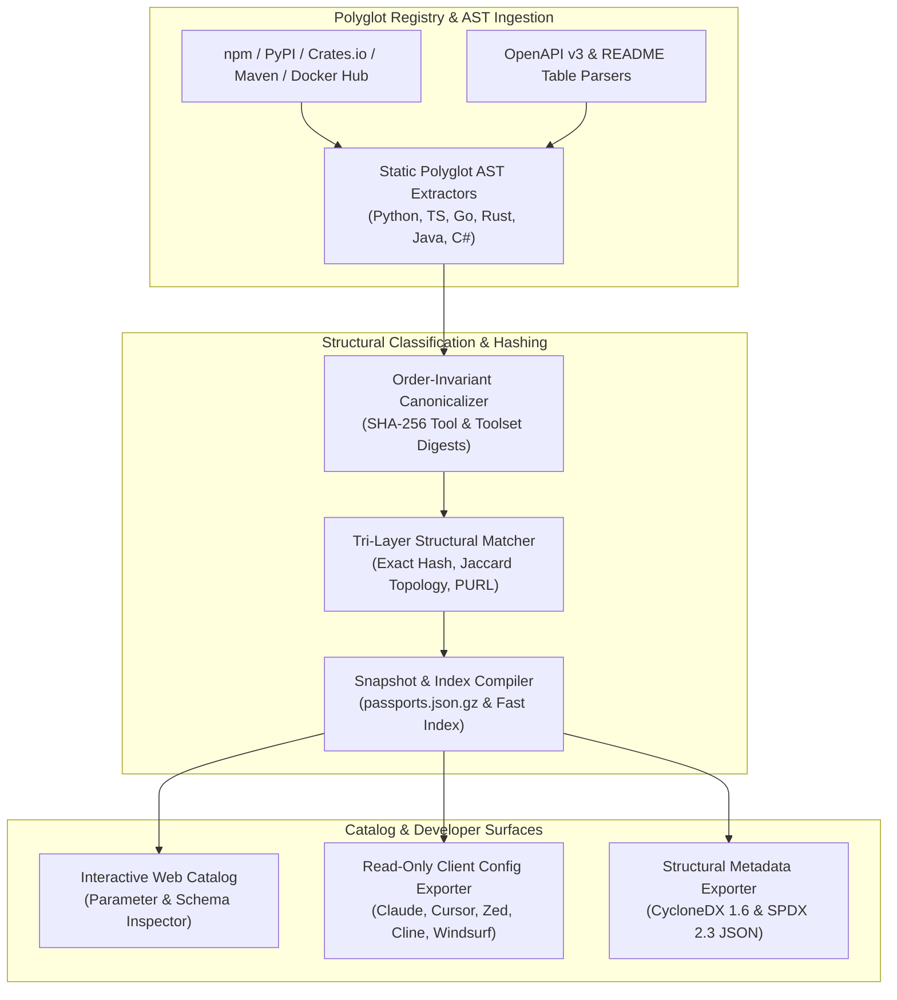

# Cumulative Master Report: MCP Registry & Catalog Ecosystem Benchmark

**Project:** `mcp-fingerprints` (Model Context Protocol Structural Classification, Cataloging & Signature Knowledge Base)  
**Scope:** Parallel MCP Registries, Catalogs, Discovery Engines, and Schema Indexers Benchmark  
**Benchmarked Ecosystems:** Smithery.ai, PulseMCP, Official MCP Registry (`modelcontextprotocol/registry`), Glama MCP Directory, Docker MCP Catalog, CycloneDX / SPDX Catalog Exports  
**Status:** 📊 Structural Classification & Registry Benchmark Specification

---

## 1. Executive Summary & Architectural Philosophy

**`mcp-fingerprints` is strictly an Open-Source MCP Server Passport, Structural Classification, and Tool Signature Knowledge Base — NOT a security tool, firewall, fuzzer, or sandbox installer.**

As the Model Context Protocol (MCP) establishes itself as the standard interface connecting language models to tools, resources, and prompts, multiple community and commercial registries have emerged to index the growing ecosystem.

`mcp-fingerprints` occupies a specialized, foundational role in this landscape: an **offline-first, zero-runtime-overhead structural identity, classification, and schema cataloging authority**. It focuses exclusively on:
* **Polyglot Static AST Extraction**: Extracting tool names, JSON Schema parameters, docstrings, prompt templates, and resource URIs across Python, TypeScript/JavaScript, Go, Rust, Java, and C# without executing untrusted code.
* **Deterministic Cryptographic Hashing**: Computing order-independent and whitespace-invariant SHA-256 digests (`canonical_hash`, `toolset_canonical_hash`) over tool contracts.
* **Workstation Configuration Discovery & Lossless Exporting**: Discovering local client configurations across 14+ AI coding agents and generating client config snippets (`export-config`) while preserving JSONC comments and formatting.
* **Structural Catalog & SBOM Metadata Export**: Publishing pre-compiled `passports.json.gz` snapshots, interactive web catalogs, and structural CycloneDX 1.6 / SPDX 2.3 metadata inventories (`export-sbom`).

---

## 2. Comparative Registry & Catalog Matrix

The following matrix benchmarks `mcp-fingerprints` against parallel MCP registries, catalogs, discovery engines, and schema indexers across core structural cataloging dimensions:

| Evaluation Dimension | `mcp-fingerprints` | Smithery.ai | PulseMCP | Official MCP Registry | Glama MCP Directory | Docker MCP Catalog |
|:---|:---:|:---:|:---:|:---:|:---:|:---:|
| **Primary Focus** | Structural Passports & Tool Signatures | Hosted Registry & CLI | Community Directory & News | Canonical Metadata Registry | Web Directory & Inspector | Containerized Server Catalog |
| **Offline-First Consolidated Snapshot** | ✅ Yes (`passports.json.gz`) | ❌ API-driven | ❌ Web/API only | 🟡 Partial (Git/API) | ❌ Web/API only | ❌ Registry API |
| **Polyglot Static AST Schema Extraction** | 🚀 **6 Languages** (Py, TS, Go, Rust, Java, C#) | 🟡 Primarily TS/Py | ❌ Metadata only | ❌ Publisher-supplied JSON | 🟡 Partial | 🟡 Container labels |
| **Order-Invariant Toolset SHA-256 Hash** | ✅ Yes (`toolset_canonical_hash`) | ❌ No | ❌ No | ❌ No | ❌ No | ❌ No |
| **Historical Version Schema Diffing** | ✅ Yes (`detect-drift` & `snapshot_diff`) | ❌ Latest version focus | ❌ No | 🟡 Version list only | ❌ No | 🟡 Image tags |
| **Local Workstation Config Discovery** | 🚀 **14+ Coding Agents** | 🟡 Client CLI flags | ❌ No | ❌ No | ❌ No | 🟡 Docker Desktop |
| **Lossless JSONC Config Exporting** | ✅ Yes (`export-config`) | 🟡 Overwrites JSON | ❌ Copy-paste snippets | ❌ Raw spec | ❌ Copy-paste snippets | ✅ Automated in Desktop |
| **Standardized Catalog Export (CycloneDX/SPDX)** | ✅ Yes (`export-sbom`) | ❌ Proprietary API | ❌ Proprietary JSON | ❌ Custom JSON Schema | ❌ Proprietary | 🟡 Container SBOMs |

---

## 3. Structural Cataloging Strengths & Ecosystem Boundaries

### 3.1 Core Structural Differentiators of `mcp-fingerprints`
1. **Source-Level Schema Recovery Without Execution**: Many MCP servers published to npm, PyPI, or GitHub do not publish machine-readable tool manifests in registry metadata. `mcp-fingerprints` recovers full `inputSchema` definitions statically from source tarballs and ASTs across six programming languages.
2. **Cryptographic Order-Invariance**: By canonicalizing JSON Schema keys, sorting required arrays, and normalizing whitespace before hashing, `mcp-fingerprints` guarantees that identical tool contracts yield the exact same SHA-256 digest regardless of registration order.
3. **Tri-Layer Runtime & Static Matching**: Unknown or custom servers can be matched against the 5,000+ passport catalog via exact hash lookup ($O(1)$), Jaccard parameter topology similarity, or package alias resolution.
4. **Pure Structural Domain Isolation**: All data models (`ServerPackageSpec`, `VersionFingerprint`, `ToolContractSignature`) strictly represent structural protocol contracts, package coordinates (`purl`), and transport requirements (`stdio`, `sse`, `http`).

### 3.2 Intentional Architectural Boundaries
To remain a lightweight, deterministic, and universally composable cataloging library:
* **Out-of-Band Operation**: `mcp-fingerprints` does not sit inline in agent network traffic or act as a reverse proxy.
* **Read-Only Configuration Synthesis**: `export-config` synthesizes and patches client configuration files cleanly without installing system daemons or managing container runtimes.
* **Structural Metadata Export**: `export-sbom` exports standard CycloneDX 1.6 and SPDX 2.3 JSON documents containing package URLs (`purl`), versions, and canonical toolset hashes for software inventory cataloging.
