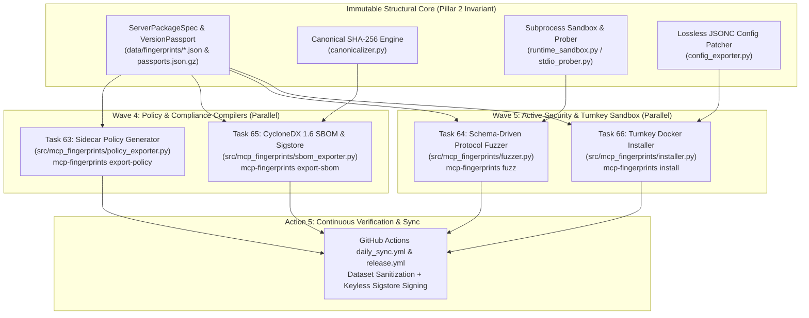
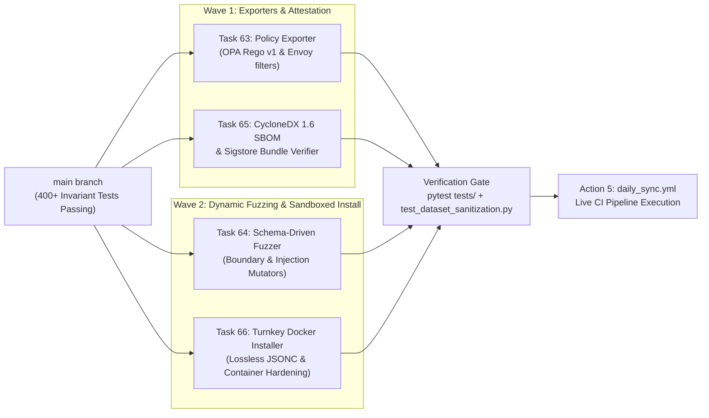

# Master Implementation Plan: Strategic Ecosystem Blueprints (Tasks 63–66 & Action 5)

**Project:** `mcp-fingerprints` (Model Context Protocol Fingerprinting, Cataloging & Invariant Verification Engine)  
**Architectural Scope:** Wave 4–6 Strategic Ecosystem Blueprints (Tasks 63–66) & CI Pipeline Verification (Action 5)  
**Upstream Reference:** [`docs/reports/ECOSYSTEM_BENCHMARK_AND_GAP_ANALYSIS_REPORT.md`](../reports/ECOSYSTEM_BENCHMARK_AND_GAP_ANALYSIS_REPORT.md)  
**Status:** 📋 Ready for EULIS (Google Jules) Multi-Wave Execution

---

## 1. Executive Summary & Architectural Philosophy

Following the comprehensive 9-Task Audit and Industry Ecosystem Benchmark (`Tasks 1–9`), `mcp-fingerprints` has validated **400+ invariant tests** across its five foundational pillars while identifying four strategic integration gaps separating static structural discovery from enterprise runtime enforcement, active security fuzzing, cryptographic supply-chain provenance, and turnkey sandboxed deployment.

Critically, implementing these capabilities **must not violate Pillar 2 (Pure Structural Domain Isolation)**: core passport schemas (`ServerPackageSpec`, `VersionPassport`, `ToolContractSignature`) remain 100% immutable, deterministic, and strictly structural. Instead, all four blueprints operate as **modular, zero-runtime-overhead compilers, exporters, and execution harnesses** consuming canonical passport artifacts.



---

## 2. DAG Execution Frontier & Dependency Topology

The 4 implementation tasks and CI verification gate form a clean 2-wave parallel execution DAG. Tasks 63, 64, 65, and 66 introduce dedicated domain modules (`policy_exporter.py`, `fuzzer.py`, `sbom_exporter.py`, `installer.py`) and converge only at the CLI subcommand registration boundary in `src/mcp_fingerprints/cli.py`.



| Task ID | Task Contract Card | Target Module(s) | CLI Subcommand | Test Suite |
|:---|:---|:---|:---|:---|
| **Task 63** | [`task_63_sidecar_policy_generator_opa_envoy.md`](task_63_sidecar_policy_generator_opa_envoy.md) | `src/mcp_fingerprints/policy_exporter.py`<br>`src/mcp_fingerprints/cli.py` | `mcp-fingerprints export-policy` | `tests/test_policy_exporter.py` |
| **Task 64** | [`task_64_schema_driven_protocol_fuzzer.md`](task_64_schema_driven_protocol_fuzzer.md) | `src/mcp_fingerprints/fuzzer.py`<br>`src/mcp_fingerprints/cli.py` | `mcp-fingerprints fuzz` | `tests/test_fuzzer.py` |
| **Task 65** | [`task_65_cyclonedx_sbom_export_and_sigstore_attestation.md`](task_65_cyclonedx_sbom_export_and_sigstore_attestation.md) | `src/mcp_fingerprints/sbom_exporter.py`<br>`.github/workflows/release.yml`<br>`src/mcp_fingerprints/cli.py` | `mcp-fingerprints export-sbom` | `tests/test_sbom_exporter.py` |
| **Task 66** | [`task_66_turnkey_docker_sandboxed_installer.md`](task_66_turnkey_docker_sandboxed_installer.md) | `src/mcp_fingerprints/installer.py`<br>`src/mcp_fingerprints/config_exporter.py`<br>`src/mcp_fingerprints/cli.py` | `mcp-fingerprints install` | `tests/test_installer.py` |
| **Action 5** | CI Pipeline Trigger (`daily_sync.yml`) | `.github/workflows/daily_sync.yml` | `gh workflow run daily_sync.yml` | `tests/test_dataset_sanitization.py` |

---

## 3. Detailed Architectural Specifications per Blueprint

### 3.1 Task 63: Sidecar Policy Generator (`mcp-fingerprints export-policy`)
* **Objective:** Close the runtime enforcement gap identified in Task 6 (`docs/reports/task6_runtime_proxies_policy_engines_report.md`) without introducing inline Python reverse-proxy latency.
* **Module Design (`src/mcp_fingerprints/policy_exporter.py`):**
  * `PolicyMode` (`Enum`): `STRICT`, `READ_ONLY`, `ALLOWLIST`.
  * `PolicyFormat` (`Enum`): `REGO`, `ENVOY`, `JSON`.
  * `RegoPolicyCompiler`: Compiles a `ServerPackageSpec` or `VersionPassport` into an Open Policy Agent (OPA) Rego v1 policy (`package mcp.authz`). Enforces:
    * Exact tool name allowlisting from `tools` / `tool_signatures`.
    * Required parameter presence and JSON Schema primitive type checks (`is_string`, `is_number`, `is_boolean`, `is_array`, `is_object`).
    * Safety hint enforcement (`readOnlyHint`, `destructiveHint`, `idempotentHint`, `openWorldHint`) and heuristic risk classification (blocking destructive or high-risk parameter patterns like path traversal `../` or `/etc/` in `read-only` or `strict` mode).
  * `EnvoyWasmConfigCompiler`: Generates an Envoy HTTP/JSON-RPC filter configuration (`envoy.filters.http.rbac` / `lua` or `wasm` payload matcher) enforcing method and tool-name allowlists at the service mesh edge.
  * `PolicyExporter`: High-level facade resolving passport by package name or file path and exporting the compiled policy string or writing to `--output`.
* **CLI Contract:**
  ```bash
  mcp-fingerprints export-policy --passport <name_or_path> \
    --format [rego|envoy|json] \
    --mode [strict|read-only|allowlist] \
    [--output <file>]
  ```

### 3.2 Task 64: Schema-Driven Active Protocol Fuzzer (`mcp-fingerprints fuzz`)
* **Objective:** Close the dynamic adversarial testing gap identified in Task 8 (`docs/reports/task8_fuzzing_guardrails_benchmark_report.md`) by synthesizing boundary and injection payloads directly from canonical `inputSchema` definitions.
* **Module Design (`src/mcp_fingerprints/fuzzer.py`):**
  * `PayloadCategory` (`Enum`): `TYPE_CONFUSION`, `INT64_OVERFLOW`, `DEEP_NESTING`, `MISSING_REQUIRED`, `SQL_INJECTION`, `PATH_TRAVERSAL`, `COMMAND_INJECTION`, `CONTROL_BYTES`.
  * `PayloadMutator`: Deterministic generator taking a `ToolContractSignature` (or raw MCP `Tool` JSON Schema) and emitting structured adversarial `arguments` dictionaries across all 8 `PayloadCategory` classes.
  * `FuzzCaseResult` & `FuzzReport` (`Pydantic` / `dataclass`): Tracks tool name, payload category, mutated arguments, latency, response classification (`CLEAN_ERROR`, `VALID_RESPONSE`, `PROTOCOL_VIOLATION`, `TIMEOUT_HANG`, `PROCESS_CRASH`), exit code, and summary metrics.
  * `SchemaDrivenFuzzer`: Orchestrates sandboxed execution over `stdio` using `RuntimeSandbox` (guaranteeing credential scrubbing `AWS_*`, `OPENAI_*`, `GITHUB_*` and strict process-group reaping) to perform JSON-RPC 2.0 `initialize` -> `tools/list` -> iterative `tools/call` fuzzing within `--timeout`.
* **CLI Contract:**
  ```bash
  mcp-fingerprints fuzz [--passport <name>] [--iterations <N>] [--timeout <sec>] [--output <file>] -- <command> [args...]
  ```

### 3.3 Task 65: CycloneDX 1.6 AI-Tool SBOM Export & Sigstore Keyless Attestation (`mcp-fingerprints export-sbom`)
* **Objective:** Close the enterprise supply-chain compliance and cryptographic provenance gaps identified in Task 9 (`docs/reports/task9_sbom_attestation_supply_chain_report.md`) while keeping `ServerPackageSpec` 100% free of mutable metadata.
* **Module Design (`src/mcp_fingerprints/sbom_exporter.py`):**
  * `CycloneDXExporter`: Exports either a single `ServerPackageSpec` or the full catalog into standardized CycloneDX 1.6 JSON (`bomFormat: "CycloneDX"`, `specVersion: "1.6"`) or SPDX 2.3 JSON (`spdxVersion: "SPDX-2.3"`).
    * Maps `purl` (`pkg:npm/...`, `pkg:pypi/...`, `pkg:cargo/...`, `pkg:golang/...`), `toolset_canonical_hash` (`alg: "SHA-256"`), sub-components for each `ToolContractSignature` (`type: "library"` / `"application"`, `mcp:tool:name`, `mcp:tool:parameter_count`, `mcp:tool:read_only_hint`), and `externalReferences` (`repository_url`).
  * `SigstoreBundleVerifier`: Verifies detached Sigstore bundle files (`*.sigstore.json`) and SHA-256 digests for `passports.json.gz` or individual passport files, validating structural integrity of the bundle (`mediaType`, `verificationMaterial`, `messageSignature`) and optional `cosign` CLI invocation when installed.
  * **CI Release Workflow (`.github/workflows/release.yml`):** Adds keyless Sigstore OIDC signing step (`sigstore/cosign-installer` + `cosign sign-blob --yes --bundle dist/passports.json.gz.sigstore.json data/passports.json.gz`) with `id-token: write` permission.
* **CLI Contract:**
  ```bash
  mcp-fingerprints export-sbom [--passport <name_or_path> | --all] \
    --format [cyclonedx|spdx] \
    [--output <file>]
  ```

### 3.4 Task 66: Turnkey Docker-Sandboxed Server Installer (`mcp-fingerprints install`)
* **Objective:** Close the 1-click ergonomics and OS container isolation gaps identified in Task 7 (`docs/reports/task7_registries_hosting_cli_report.md`).
* **Module Design (`src/mcp_fingerprints/installer.py` & `src/mcp_fingerprints/config_exporter.py`):**
  * `SandboxMode` (`Enum`): `DOCKER`, `NONE`.
  * `NetworkPolicy` (`Enum`): `NONE`, `BRIDGE`.
  * `DockerSandboxBuilder`: Translates passport metadata (`ecosystem`, `package_name`, `startup_command`, `required_env_vars`) into a hardened ephemeral Docker container invocation:
    * `command`: `"docker"`
    * `args`: `["run", "-i", "--rm", "--network", "<none|bridge>", "--read-only", "--cap-drop=ALL", "--security-opt=no-new-privileges", ...env_passthroughFlags, image_or_runtime_cmd]`
  * `ClientInstaller`: Resolves package from local catalog/passport, builds either a Docker-sandboxed or native runtime server entry (`npx`, `uvx`, `docker`), and uses `config_exporter.py`'s lossless JSONC patcher to inject the server into target client configuration files (`claude`, `cursor`, `windsurf`, `zed`, `cline`, or `all`) while preserving comments and formatting. Supports `--dry-run` to preview the exact JSONC patch without writing to disk.
* **CLI Contract:**
  ```bash
  mcp-fingerprints install <package_or_passport> \
    [--client claude|cursor|windsurf|zed|cline|all] \
    [--sandbox docker|none] \
    [--network none|bridge] \
    [--read-only] \
    [--dry-run]
  ```

---

## 4. Verification Gates & Invariant Protection Plan

Every task implementation must pass three verification gates before merging to `main`:

1. **Dedicated Unit Test Gate:**
   * `pytest tests/test_policy_exporter.py` (Task 63)
   * `pytest tests/test_fuzzer.py` (Task 64)
   * `pytest tests/test_sbom_exporter.py` (Task 65)
   * `pytest tests/test_installer.py` (Task 66)
2. **5-Pillar Live Invariant Regression Gate:**
   * All 400+ existing tests across `tests/test_live_*.py` and `tests/test_dataset_sanitization.py` must pass with zero regressions.
   * Specifically verify `tests/test_live_canonicalizer_snapshot_invariants.py` to guarantee no forbidden dynamic fields were introduced into `ServerPackageSpec`.
3. **Action 5 Live CI Sync Verification:**
   * Trigger `.github/workflows/daily_sync.yml` on `main` via `gh workflow run daily_sync.yml --ref main` and verify clean initialization and dataset sanitization compliance.
