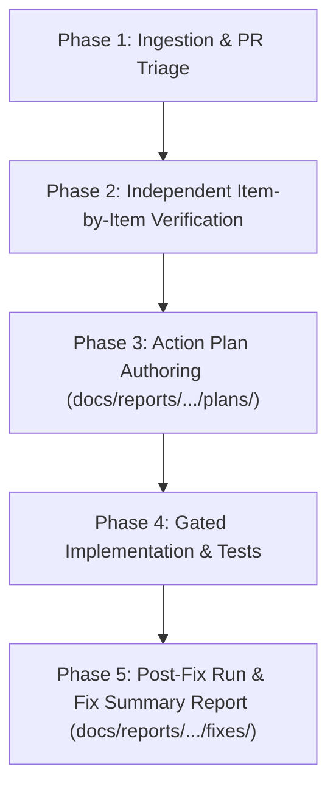

# Workflow Standard: Autonomous Processing of Daily Web Card Audit Reports

> **Target Profile**: Autonomous AI Agent / Orchestrator  
> **Frequency**: Triggered automatically upon generation of a new daily audit report (`docs/reports/daily_web_audits/runs/YYYY-MM-DD_*.md`) or submission of an automated PR.  
> **Invariants**: Deterministic 5-step lifecycle, strict zero-security domain isolation, mandatory source file references, and dedicated report directory separation.

---

## 1. Overview & Directory Architecture

When an automated scheduled run (e.g. from `./bin/run-daily-card-audit.sh` or a Jules automated worker) publishes an audit report, the agent must not blindly merge or accept the findings. Instead, it must follow an end-to-end audit triage and remediation lifecycle.

### Storage Layout Invariants
All artifacts produced across this lifecycle MUST be filed under their dedicated subdirectories:

```
docs/reports/daily_web_audits/
├── master_audit_summary.md                            # Historical run ledger
├── runs/                                              # 1. Raw daily audit runs (YYYY-MM-DD_HHMMSS.md)
├── reviews/                                           # 2. Verification reports (YYYY-MM-DD_verification_report.md)
├── plans/                                             # 3. Action plans (YYYY-MM-DD_remediation_plan.md)
└── fixes/                                             # 4. Fix summary reports with source file links (YYYY-MM-DD_fix_report.md)
```

---

## 2. The 5-Phase Autonomous Audit Resolution Lifecycle

Every incoming audit report must be handled through the following 5 phases:



---

### Phase 1: Ingestion & PR Triage
1. **Identify the Trigger**:
   - Check open PRs (`gh pr list --search "daily web cards quality report"`) or new report files under `docs/reports/daily_web_audits/runs/`.
2. **Parse Findings**:
   - Extract the findings table and count entries across status categories:
     - `MISMATCH` (card tools != source tools)
     - `MISSED_TOOLS` (code/docs contain tools missed by card)
     - `UNRESOLVED_SOURCE` (upstream repository cannot be reached or resolved)
     - `UNREACHABLE_REPO` (HTTP 404, private repository, or renamed repo)
     - `PERFECT_MATCH` (card data matches source truth)

---

### Phase 2: Independent Item-by-Item Verification
The agent MUST NOT assume the raw audit report is 100% accurate (as demonstrated by PR #58 where missing URLs created false mismatches).

1. **Verify Mismatches & Zero-Tool Classifications**:
   - For every flagged mismatch, check if the upstream source was actually reached.
   - Inspect package registries (`npm`, `PyPI`, `crates.io`) to verify if a valid repository exists.
   - If repository URL was missing, classify as an **Auditor Gap**, not a package mismatch.
2. **Verify Missed Tools**:
   - Check the upstream repository's `README.md`, `docs/`, `openapi.yaml`, and code entrypoints.
   - Confirm whether missing tools are in unparsed AST patterns, Markdown tables, or dynamic registration loops.
3. **Author Verification Report**:
   - Store report in: `docs/reports/daily_web_audits/reviews/YYYY-MM-DD_verification_report.md`.
   - Separate findings into:
     - **Confirmed Real Gaps** (actual bugs in AST/catalog extraction).
     - **Auditor False Positives** (flaws in the auditor's detection logic).
     - **Unreachable/Private Repositories** (genuine upstream 404s).

---

### Phase 3: Action Plan Authoring
Author a concrete, prioritized technical plan before writing code:
- **Output File**: `docs/reports/daily_web_audits/plans/YYYY-MM-DD_remediation_plan.md`.
- **Contents**:
  1. Root cause summary of confirmed gaps and false positives.
  2. Targeted modules to modify (e.g., `ast_parser.py`, `deep_zero_tool_auditor.py`, `doc_parser.py`).
  3. Registry lookup / schema parsing enhancements required.
  4. Test contract and acceptance criteria.

---

### Phase 4: Gated Implementation & Verification
1. **Execute Changes**:
   - Implement the fixes in `src/mcp_fingerprints/`.
   - Strictly adhere to clean architecture and zero security keywords.
2. **Author Unit Tests**:
   - Add unit tests under `tests/` explicitly validating the fixed cases (e.g. `tests/test_audit_remediation.py`).
3. **Execute Repository Test Suite**:
   ```bash
   PYTHONPATH=src .venv/bin/pytest -q tests/
   ```
   Must pass 100% with zero regressions.

---

### Phase 5: Post-Fix Run & Fix Summary Report
1. **Re-Execute the Daily Audit Script**:
   ```bash
   ./bin/run-daily-card-audit.sh
   ```
   Verify that false positive mismatches drop to 0 and all valid cards are accounted for.
2. **Author the Post-Fix Summary Report**:
   - **Output File**: `docs/reports/daily_web_audits/fixes/YYYY-MM-DD_<topic>_remediation_fix_report.md`.
   - **Mandatory Content**:
     - Direct markdown links to modified source files and specific line ranges:
       - `[src/.../deep_zero_tool_auditor.py#L120-L165](file:///...)`
       - `[tests/.../test_audit_remediation.py](file:///...)`
     - Cross-references to the Task specification, the Action Plan, and the Review Report.
     - Before-vs-after metrics table.
3. **Commit & Auto-Merge**:
   - Commit report artifacts and verified code:
     ```bash
     git add src/ tests/ docs/reports/daily_web_audits/
     git commit -m "feat(audit): resolve daily card audit discrepancies for YYYY-MM-DD [skip ci]"
     git push origin main
     ```
   - If an automated PR (e.g. from Jules) was open, close it as superseded by the verified commit on `main`.

---

## 3. Autonomous Decision Matrix

| Encountered Condition | Automated Decision | Required Action |
|:---|:---|:---|
| Discrepancy due to missing GitHub URL on card | **False Positive** | Use PyPI/npm API lookups. Mark as `UNRESOLVED_SOURCE` (`?` tools) if truly missing. Do NOT flag as `MISMATCH`. |
| Tools listed in README table but missing in AST | **Parser Gap** | Ingest markdown table tools via `doc_parser.py` if table count > AST count. |
| Non-standard Go / Python / TS tool decorators | **AST Gap** | Add AST pattern match in `ast_parser.py` and add unit test. |
| Upstream repo returns HTTP 404 | **Dead/Private Repo** | Mark status `UNREACHABLE_REPO`. Retain historical passport metadata. |
